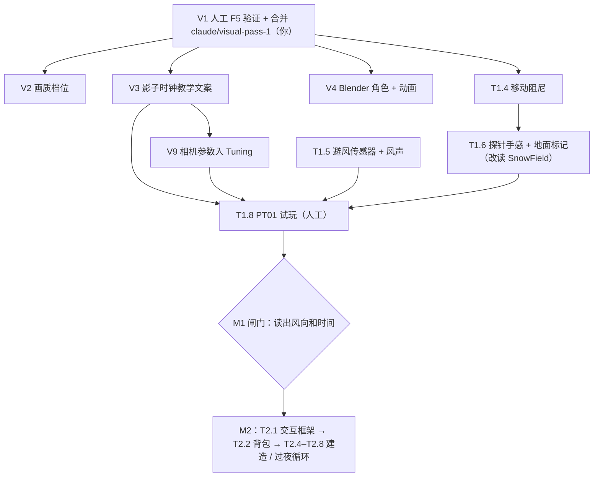
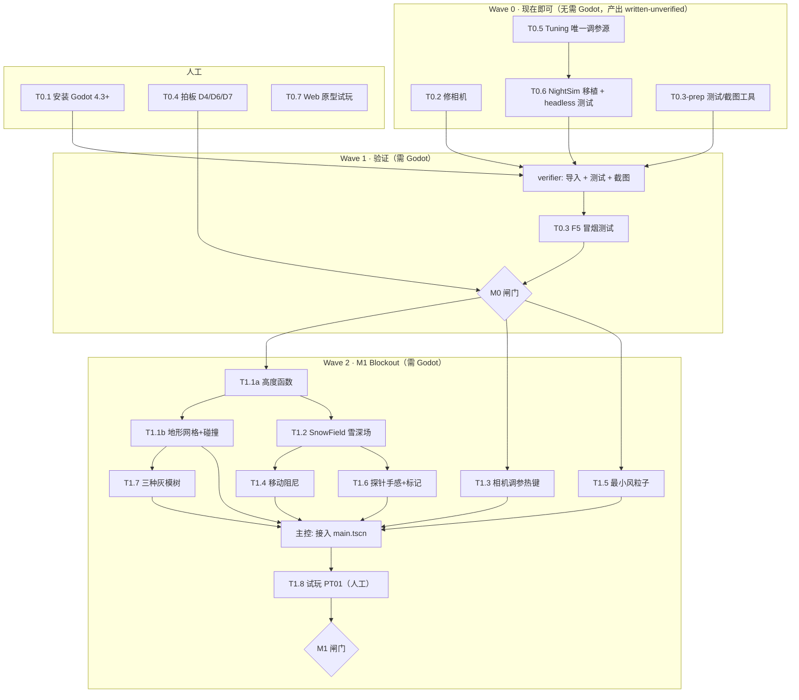

# CURRENT_STAGE.md — 当前施工合同

> **修订**：2026-11-21 · **当前阶段**：0.7 Android 测试版（U1 已通过 X1T 实机验证并打包正式签名 APK 供手机试玩）→ **U0/U1 真机试玩反馈** → U2 双营址构图 ‖ U3 雪地接触面着色融合 → U4 三时刻晨报 → U5 首章第 2 关 A/B 真人试玩闸门
> **上游**：任务定义与闸门见 [`PRODUCTION_PLAN.md`](PRODUCTION_PLAN.md) §4.U（D18）；规则归并见 [`CORE_GAMEPLAY.md`](CORE_GAMEPLAY.md) §14；视觉红线见 [`VISUAL_LANGUAGE.md`](VISUAL_LANGUAGE.md) §3.1；提案原稿归档于 `references/historical-plans/2026-11-20_rethink_proposal.md`；协作与诚实验证规则见 [`AGENTS.md`](AGENTS.md) §5–§7；状态投影见 [`progress.yaml`](progress.yaml)。
> 本文件只回答"**现在做什么、谁来做、按什么顺序、做到什么算完**"。

---

## 当前任务：0.7 体验聚焦 — U 轨道（D18，2026-11-21 更新）

用户批准归并《开发文档_重新思考》提案至权威文档，率先完成 **U1（HUD 减法与三意图触屏重构）** 并授权编译正式签名 **0.7 Android APK（versionCode 7）** 供原手机同屏实测阴影与新触屏界面。在 U5 真人试玩闸门通过之前，暂停新增章节与庇护所种类。

| 顺序 | 任务 | 状态 | 执行者 | 说明 |
| :--- | :--- | :--- | :--- | :--- |
| 0 | **U0** 原 Android 手机 0.6/0.7 阴影与触屏实测 | `blocked`（待人工实机） | 用户 | 安装 0.7 APK 在原手机同地图边走边看，一并核验长阴影硬边、新 HUD 视野、防误睡与真机帧率 |
| 1 | **U1** HUD 减法 + 三意图触屏 + 防误睡 + 铺位硬事实 + 单焦点世界标签 | `done`（技术验收通过，待真机体验） | Agent | X1T Godot 4.3.stable 验证通过：18 suites / **4362 assertions PASS**（含 `loc` 2955 项、`build_session` 93 项、`game_rules` 72 项）、`touch_smoke_test.gd`（`--touch --touch-css=390`）PASS、`camp_detail_review.gd` PASS（近景绘制 506 / 三角形 207,725，xvfb 软光栅，非真机帧率）；对比截图 `snapshots/u1_hud_camp_close.png`、`snapshots/u1_hud_camp_play.png` 已审阅并微调右上菜单与天气卡间距 |
| 2 | **U2** 首章“两根探针”双候选营址构图 ‖ **U3** 踩实雪与岩脚接触面合入雪面 Shader + 近景岩体单变量对照 | `todo` | Agent | 收到真机反馈后并行推进（文件不相交） |
| 3 | **U4** 夜间冷醒停表代价透明 + 三时刻故事化晨报 | `todo` | Agent | 复用 `NightCurve` 真实重算反事实建议，首屏只展开 1 项主因 |
| 4 | **U5** 首章第 2 关 A/B 真人试玩闸门 | `todo` | 用户 + 测试者 | 同存档对照旧版与 0.7 精简界面，回答三问（为什么睡这 / 哪次往返最值 / 明天改什么） |

### U1 任务卡与验收回执（`done` — 技术验收通过，0.7 APK 已准备供真机测试）

```text
Task:       U1 HUD 减法与三意图触屏重构（D18）
Read first: CORE_GAMEPLAY.md §14, VISUAL_LANGUAGE.md §3.1, PRODUCTION_PLAN.md §4.U, AGENTS.md §5
Files:      scripts/systems/touch_mode.gd, scripts/ui/touch_controls.gd, scripts/ui/game_ui.gd,
            scripts/ui/hud_warmth.gd, scripts/ui/world_callouts.gd, scripts/systems/game_rules.gd,
            scripts/systems/game_director.gd, localization/messages.csv,
            tests/test_build_session.gd, tests/test_game_rules.gd
Depends:    0.6 (99476e4)
Status:     done（X1T Godot 4.3.stable 技术验收通过；原 Android 手机真机体验随 0.7 APK 同步开展）
Evidence:
  - tests/run_all.gd：18 suites / 4362 assertions PASS，0 failures（含 loc 2955 项、build_session 93 项、game_rules 72 项）
  - tools/touch_smoke_test.gd -- --touch --touch-css=390：RESULT PASS
  - tools/camp_detail_review.gd -- --low --touch --touch-css=390：CAMP REVIEW PASS（draw_calls 506 / triangles 207725，xvfb 软光栅非真机 FPS）
  - 前后对照截图：snapshots/camp_detail_20261119_after.png vs snapshots/u1_hud_camp_close.png、snapshots/u1_hud_camp_play.png
  - 审图微调：中文天气卡自动加宽后与右上菜单键接近，已将 top 槽位再左移 36 px 留足边距
```

**0.7 Android 测试版交付核验（2026-11-21）**：构建 `d05e35d`（`versionCode 7`，与 0.6 同正式签名 `O=bobbik, OU=Android, CN=bobbik`），已通过 18 suites / 4362 assertions、`touch_smoke_test.gd`、`APK CONTENT PASS` 并上传至 `https://test.bobbik.org/winter/download/`（`winter-shelter-d05e35d.apk`，31,514,543 bytes，本地与公网回拉 SHA-256 一致：`2a57f7ba083570b45f4f925f7edd81795465c925905cea2dda57a4f9d1918d9b`）。等待原手机实机试玩反馈（一并核验 0.6 长阴影与 U1 新 HUD / 防误睡）。

---

## 雪洞雪色修正与 0.4 发布（2026-11-19）

用户确认雪屋应与相邻雪地呈现相同雪色，并授权打包上线。雪洞外壳、雪裙和弃雪共用地面雪色着色，色调取工地周围的雪深和倾角，外形仍按自身法线受光。洞内材质保留深度指示。雪裙和施工覆雪贴合地形三角面，压雪从中心向边缘减弱。没有增加绘制层，物理、雪深与保暖规则保持原状。固定机位截图 `snapshots/snow_match_v04.png`，X1T 手机低档白天、夜晚窗口和触屏流程通过。

0.4（code 4）已以 `014d907` 发布到 Web、APK 下载页和 GitHub Release。核验见 `playtests/v04_20261119_delivery.json`。

### 0.4 画面诊断

默认关卡固定机位、中档、下午、拉远镜头检查。关闭冰湖和太阳阴影后，远处树林中的白带仍在；隐藏 FarTerrainMesh 后白带消失。远景网格在地图四边中段沿边缺少采样，单边跨度达 100 米，而远树按连续高度函数落点。优先让远景内缘与可玩地形共边、近远雪材质过渡，并让树根贴合实际三角面。Compatibility 下实测景深关闭；人物前方的清晰度横线尚未可靠复现，需在对应视角移动镜头区分地形边界和级联阴影。

本地预览已沿地图内缘逐米对齐高度，并让远树按绘制三角面落点。相同机位、14:20、中档实机渲染对照见 [林坡局部对比](snapshots/far_terrain_preview_comparison.jpg) 和 [调整后全景](snapshots/far_terrain_preview_full.jpg)。林间直边在此机位消失，远雪材质仍较平。人物前方横线与 Android 帧时间待验。

0.5（code 5，构建 `481a5ad`）已发布至 Web、APK 下载页及 GitHub Release。APK 与 0.4 同签名，公网下载哈希与本机构建一致。[交付核验](playtests/v05_20261119_delivery.json)。

### 0.5 实机反馈：近处雪面的阴影硬边

实机截图将位置标在角色与枯木之间。固定太阳与机位后，禁用方向光阴影使本地相似硬边消失；只关闭地形投影仍有树影硬边。手机兼容渲染试用单张方向光阴影图和低档软阴影过滤，沿用各档距离与原有分辨率。已检查三档设置及[同机位局部对照](snapshots/mobile_snow_shadow_comparison.jpg)。树影变柔，部分林冠轮廓仍呈折线。待原设备同地点验证。

已发布 [GitHub Release v0.6](https://github.com/bobbik1984/winter-shelter/releases/tag/v0.6)，Android 构建 `514ef9b`，versionCode 6，与 0.5 同签名。GitHub APK 与本地 SHA-256 一致，4281 项逻辑断言、触屏流程与 APK 内容校验通过。原手机的阴影效果待复测。

## 当前任务：CAMP-DETAIL（2026-11-19）

用户认可将视觉投入转向岩脚积雪、营地生活痕迹和雪面层次，不再比较细微树形。实施一块真实世界内庇护所样板并接入已有施工刷新：连贯旧树回归；静态入口踩实雪与侧边弃雪；真实材料堆的网格与批绘；岩面覆雪融合与抑制均匀雪晶噪点。材料显示必须来自 SitePile，装饰不成为虚假可采资源，不改变雪深、地形、碰撞、火、保暖或太阳方位。树丛重排与新增灌木延后，避免改变可读路线。

验收：同固定机位前后近景 / 正常距离 / 岩石 / 夜景截图，手机低档原生窗口短测；封闭入口不得被弃雪堵住；阶段 0 无施工痕迹、阶段 1 保留既有开挖外观、入口整理从阶段 2 开始、后续阶段不重复累积节点、空材料堆无假柴；贴合旋转 / 斜坡雪面、冰面过滤、几何预算与有限法线测试；逻辑及触屏回归。截图中的已完工与材料库存为明确测试布景，不冒充完整人工通关。仅源码实施及本机验证，不自动打包部署。待视觉审阅。

验收进展：代码接入并完成本机技术验证，整体视觉待用户审阅。18 suites / 4281 assertions PASS，其中营地 31 项；原生窗口验证施工阶段切换不重复留节点、雪裙朝上、空库存无材料、12 柴 / 4 垫层的重复刷新只有两组批绘、地物锚点和库存均不变。触屏整局已通过建造、进洞、睡眠、起床、重试；材料摆位补充为避让真实树冠 / 岩体，仍沿用以工地为中心的耗料和卸货规则。设置位于 EnvironmentDetailSettings；全局更新近树与岩面 / 雪晶，工地细节则随工地阶段出现，不需要单独开启测试场景。

X1T UHD620，1920×1080 / 手机低档 480 3D 高度，固定机位前后：近景绘制 592→541、三角形 254087→220545；正常距离 594→543 / 254602→221060；岩石 362→354 / 132662→130580；夜景 347→324 / 121829→107819。均约 30 FPS，受限帧约束。组合调整包含旧树回归和批绘，不能把减少量全部归于新增营地细节；不是 Android 真机持续帧率 / 温度验证，GPU 计时 0 不可用。Godot 原有渲染后端限制与退出资源清理提示仍在，逻辑日志中的备份失败由旧存档异常测试主动构造。

证据 `playtests/camp_detail_20261119_results.json`，截图 `snapshots/camp_detail_20261119_{before,after,clean,rock_before,rock_after,stock,night}.png`；原始图与日志在 `~/work/local/stage/winter-shelter/camp-detail-20261119/`。无 UI 图仅供美术观察，性能统计使用有 UI 的原生窗口。窗口中高床雪洞与库存为声明的布景，触屏整局另行回归。此轮属于组合与基础表现改进，尚未达到参考图的雕刻岩面、细致雪材质和庇护所资产丰富度，不把技术通过当作用户美术接受。未打包、部署或推送 GitHub，线上 / APK 仍为 0.3。aligner reviewed-patch dry-run 仍因注册路径 `common/wild/todo.md` 缺失而失败，未直接改写 todo/progress。

### 后续画面评估（方案建议，待实施）

对照 `references/frost_punk_ref.png` 和本轮营地、岩石截图，优先优化**雪面与物体的接触过渡**，其次才是主要岩体轮廓和雪洞入口材质。当前岩脚仍有浅色多边形外边，入口踩实雪有独立贴片感。营地与岩脚装饰取连续高度函数，地形实际由 1 m 网格三角面绘制并生成碰撞。Godot 4.3 headless 在默认种子 7 的营地附近（x=17–25，z=1–9，0.1 m 步长）采样 6561 点，连续高度与三角面插值最大差约 3.2 cm，超过入口 1.4 cm 抬高与岩脚 1.8 cm 下沉量；截图边缘还受独立材质色差影响。现有三种岩体 GLB 各 124–128 三角形，可用于轮廓对照。

建议先在同一营地做两次单变量对照。第一步把踩实雪和岩脚浅色过渡合入原有雪面着色，局部掩码优先复用地形数据，真正隆起的弃雪保留少量几何并按实际三角面贴合。第二步用现有岩体网格测试替换一组近景圆石，复用原实例、碰撞与材质槽，比较岩面形状与覆雪关系；仅当普通游玩距离效果不足时再制作新资产。第一步和第二步分别在固定机位的白天、阴天和低档 480 高度验证，记录相同视角的绘制量与未限帧帧时间；Android 持续性能与温升单独实测。上述为分析建议，并未实现或发布。

## TREE-SAMPLES（2026-11-18，已结束比较，转 CAMP-DETAIL）

用户批准按 TREE-LOOK 结论推进样树测试。范围：三种资源化候选（饱满、略疏、下垂枝），保留原版基线；同机位 / 光照 / 材质 / 风向 / 缩放的单树对照，手机低档临时成林截图与绘制/帧率采样。以连贯锥形树冠、搭接枝层、贴附积雪为目标，允许局部不规则轮廓。原地物坐标、雪深、可采资源、碰撞与玩法不变。

验收：候选网格有限、正面方向正确、固定种子可复现，零风与参数边界有回退，原版 / 远景网格不变。每种树在正常游玩距离和近景均可辨识；实际窗口比较低分辨率成林，给出候选建议与性能代价。先交付候选预览供用户审阅，暂不永久替换整个森林，不打包或部署。

验收进展（2026-11-19）：三种候选与对照工具已实现，技术验证完成，等待用户视觉选择。0 为原版（542 三角形）；A 为饱满型（664）、B 为略疏型（576）、C 为下垂枝型（608）。最终方案基于旧版连贯枝层做资源化变体，单不透明表面，无新增纹理、面片或每树处理；平滑雪锥 / 环状枝层与简化针叶裁切面片的试验未达画面要求，未纳入最终代码。研究试验存放项目外，不把某次试验失败推广为该技术不可用。

最终逻辑 17 suites / 4250 assertions PASS，其中候选 54 项：封闭体、面朝向一致、有限单位法线、固定种子、风向偏冠、树冠高度无空白带、异常参数回退、原版 / 远景保持及候选未暗中替换生产路径。真实窗口同时交付近景和正常距离单树对照，以及每种候选临时成林图；树干 / 资源 / 岩体登记坐标逐项不变，所有运行参数与网格只在测试进程内改变和恢复。

X1T UHD 620 / 1920×1080：手机低档（480 3D 高度，UI 原分辨率）0/A/B/C 短时采样为 30.01/29.98/30.01/30.00 FPS，绘制均 643；三角形 232467/254671/238655/244479（A +9.55%、B +2.66%、C +5.17%）。中档为 24.03/23.93/25.24/24.46 FPS，绘制 942/943/942/943。不是手机真机持续帧率 / 发热验证；限帧轮 GPU 计时 0 不可用；原有退出清理警告仍存在。对照统一使用针叶色增益 1.5、固定风向并冻结枝摆，避免时间差干扰形态比较；此调色不写回生产材质。

补充取消限帧采样：临时将内存中的游玩预算设为 0 并逐项断言 `Engine.max_fps == 0`，结束恢复；0/A/B/C 为 63.14/49.50/54.69/48.54 FPS。此为一次顺序短测，含 UI / 预热 / 温度波动，不能将差值归因于树模型或视为长时性能余量保证。启用 GPU 测量后末帧为 20.47/17.86/10.34/13.98 ms，非均值，不用于候选排序。结果和限制均存入同一证据 JSON。

回执：`playtests/tree_samples_20261119_results.json`；`snapshots/tree_samples_20261119_{gallery,mobile_gallery,forest_A,forest_B,forest_C}.png`；原始桌面 / 手机图和日志在 `~/work/local/stage/winter-shelter/tree-candidates-20261118/`。当时建议 A 作主树候选，B/C 少量混入；用户随后认为四版差异不足以继续比较，已转 CAMP-DETAIL 并采用连贯旧树。此段保留样树轮次的历史事实；线上 / APK 仍为 0.3。公共进度投影仍须通过 aligner 的注册路径修复后对齐。

## 当前任务：TREE-LOOK（2026-11-18，用户视觉退回）

用户明确反馈 ENV-DETAIL 新树冠过于零散，效果不如修改前，要求研究合理表现。该反馈覆盖上一轮树形候选的正向评价；工程测试 PASS 不能作为树木美术通过的依据。此次只研究和对照，未修改游戏树模型或发布。

评估完成：源码将原来连续枝层改成 6 层、每层 6 组薄菱形枝片，层间约 0.92 m，枝片高度仅为枝长的 0.11；枝片缺乏搭接，整体树冠被挖空，白雪 / 暗叶对比又强化孤立形状。在手机低分辨率下，细木枝连接丢失，雪片成为碎点。实测近景面数旧版 542 / 新版 596；本次稀疏不是性能预算所迫。

真实窗口同机位、同一套现有补光 / 材质 / 画质 / 地物位置，只在临时进程中替换旧树网格，对照完成：`~/work/local/stage/winter-shelter/tree-look-research-20261118/{current_fragmented,legacy_coherent_same_light}.png`；日志同目录 `winter-tree-research.log`。结论：旧版整体轮廓更连贯，当前分离枝片形态不接受。正式来源仍为 0.3；本地游戏源码仍停留在 c6b19ec，未把临时对照替换写回。

下一候选建议（研究建议，尚未实现或获视觉确认）：以饱满、连续、略不规则的锥形树冠为主；枝层重叠、枝梢下垂，局部露干；积雪贴附枝叶上侧，保持灰绿叶层的连续体积。优先试不透明叶团 + 少量轮廓细节，局部裁切面片为候选增强；先做 2–3 棵样树，在正常机位、建造近景和手机低档对比，通过视觉审阅后再替换整片森林。研究来源与细则见 VISUAL_LANGUAGE §2.3b。

## 当前任务：ENV-DETAIL（2026-11-18）

用户要求参照 `references/frost_punk_ref.png` 增加当前环境细节，并兼顾手机持续性能。范围：近景云杉的分枝与积雪轮廓、岩脚贴地积雪与碎石组合、脚印压痕及施工区细节，校准日夜环境补光以保留阴影细节；复用不透明材质、单 surface 和分块批绘，不增加实时灯光/全屏效果。树干、岩体位置及碰撞、可采资源、雪深、风向、夜间规则保持现有契约；远景仍用简化树。

验收：同场景同机位前后截图及帧率/绘制量对照；云杉变体保留迎风短枝，不再是完整层叠锥面；新装饰服从雪面、坡度与冰面，且不成为虚假资源；脚印有脚掌/边缘层次并受固定实例预算约束。覆盖网格有效性、固定种子、低细节远景和正常/异常配置；逻辑与场景回归。仅实施和验证，不在本轮自动构建或部署；正式发布仍为 0.3。

验收结果：源码实现及本机技术验证完成；本轮用户视觉审阅明确退回树形（见 TREE-LOOK），其余环境细节不因此自动获得用户认可。未构建或部署，线上 / APK 仍为 0.3。最终逻辑 16 suites / 4196 assertions PASS（环境细节 36 项，含固定种子、面数预算、网格朝向、异常配置、冰面过滤和不修改地形/地物）；触屏整局、键盘整局、地物回归 PASS。固定机位真实窗口覆盖日间 / 阴天 / 夜间、洞口暖光代理隐藏与灯强度约束，桌面和手机配置均 RESULT PASS。树干、可采枯木、岩体登记位置逐项与改前一致。

本机 X1T UHD 620，1920×1080 窗口：中档三个视角绘制 940→944 / 524→528 / 968→972，三角形增加约 1.04%–4.38%；帧率由 24.2/26.6/22.9 到 23.5/26.4/25.7，属于同一量级波动，不宣称提速。低档手机配置模拟三个视角 29.99/30.00/30.01 FPS（480 高度渲染、UI 原分辨率）；不是 Android 真机温度或性能实测。新增装饰生成通过一次性采样缓存由约 977 ms 降至 459–488 ms，不做逐帧生成。GPU 计时返回 0，不可用；原有退出资源 / 纹理清理提示仍存在。

近景审查发现新增面的绕序使鞋印与部分表面朝下，已按 Godot 顺时针正面规则修正，并补上鞋底 / 雪沿向上、树皮向外的测试；最终截图已确认可见。洞口旧 GLB 自发光矩形隐藏，既有灯内移并降低强度，没有新灯或加温规则。证据 `playtests/env_detail_20261118_results.json`、`snapshots/env_detail_20261118_{before,after,entrance,night}.png`；原始日志与完整桌面/手机截图在 `~/work/local/stage/winter-shelter/env-detail-20261118/`。已通过公共 aligner 对本轮 todo 投影执行 reviewed-patch dry-run，仍因注册相对路径 `wild/todo.md` 不存在而终止；未直接改写进度投影。

## 当前任务：C1-COMPACT / RELEASE-03（2026-11-17）

用户已同意第一章精简为三个主线课题，并明确授权更新线上与 APK。范围：第一章三个资源化教学配置、第三关开放第二章、旧 4–10 关转可选挑战、存档兼容、双语 UI、回归与 0.3/code 3 发布；包含已提交但未发布的 MENU-DEFERRED / NIGHT-RECOVERY 修复。其他章节的十关结构保持当前设计。

验收：首屏第一章只显示三个主线关；每关有不同课题，第二关以相同天气比较高床结构，第三关练过夜准备。主线第三关通过后默认进入第二章，可选挑战独立标识且不阻挡主线。旧进度、地图计数和最佳成绩保留，迁移前备份；正常/边界/旧存档测试及触屏回归通过。正式签名 APK 可覆盖旧包；GitHub、下载页和 Web 来源一致并核对公开下载哈希。构建暂存放项目外，保留旧包，不安装新依赖。

验收进展：15 suites / 4160 assertions PASS，触屏整局、输入整局、地物回归均 PASS。真实窗口专项验证第一章三按钮、第二关课题中英切换、第三关 13:00、通关默认去第二章、七个可选挑战及返回主线，RESULT PASS；截图 `snapshots/compact_chapter_*.png`，末帧 21 FPS（并发测试期间，GPU 计时不可用）。规划机器人按真实资源与步行耗时完成默认地图三条准备路线，实际返回铺位后评估：BasicCave SAFE/最低 63、高床 SAFE/90、第三关高床 SAFE/84；这是路线模拟，不代替手机人工试玩。旧机器人卸货点在门外，已修正为过夜评估前走入实际铺位；未放宽保暖规则。逻辑测试退出时仍有既有 ObjectDB/Resource 清理警告。

发布完成：0.3 / versionCode 3，发布代码 `9547f4ea8803dd1696636fd67ce7f05df060c24d` 已推送 master，GitHub Release `v0.3` 已附正式签名 APK 与校验清单。Web 标记 `9547f4e`，PCK `index-4c02213836.pck`；595 项导出资源属性与源码一致。APK 31,475,824 bytes，SHA-256 `e7c9b1c3efa05fe36098cf5f07bf5b584af818075756f28d03102bf00c8fc6b9`；版本、arm64 架构、与旧版相同的正式签名及包内三关/翻译/手机配置检查 PASS。下载页已切换 0.3；从公网重新下载 APK 与 PCK 后全文件哈希均与本地产物一致，GitHub 资产 digest 同样一致。旧 APK 保留。证据 `playtests/v03_20261117_delivery.json`；入口见 HANDOVER_CODEX §6。未连接 Android 真机，安装及手机温度实测仍待用户验证。`project_aligner.py` 的公共注册相对路径仍指向不存在的 `wild`，因此不直接改 `progress.yaml` / `todo.md`；待公共映射修正后对齐。

## 当前任务：MENU-DEFERRED / NIGHT-RECOVERY（2026-11-16）

来源：用户实机反馈选章/选关延迟、天黑强制睡眠形成死循环、夜间添柴位置与外出操作不清楚。

- 范围：简报选择/开始加载、睡眠与自由行动切换、实际睡点判定、火源说明、中英文案和对应回归；规则并入 CORE_GAMEPLAY，结构并入 ARCHITECTURE_GODOT。
- 验收：箭头与换图不重载场景；开始后才按所选配置重建一次，并显示加载反馈。天黑继续自由行动；夜里可主动醒来、起床移动、采集和添柴；重复起床/入睡不重置日出截止、燃料、最低保暖值或已发生的夜间记录。远离工地睡觉按实际露天状态计算。封闭雪洞/开放棚屋/帐篷炉分别说明火的位置和供热范围。
- 验证：纯逻辑正常/异常路径、真实输入关卡切换与夜间往返、触屏及双语覆盖；截图附帧率与不可测项目。既有图、存档和玩家设置保留。
- 权限：当前获准实施和测试；本轮未获新的打包/部署指令，不构建或发布安装包。回滚锚点 cb4afa7；不安装依赖、不迁移项目目录。

验收结果（2026-11-17）：源代码修复已通过验证。逻辑 15 suites / 4105 assertions PASS；触屏整局、键盘整局、场景回归 PASS；真实窗口专项覆盖选关控件同步、开始前加载提示、天黑保留移动、露天不借用远处庇护、真正进入洞内睡觉后起床退出室内相机、室外添柴/采木、各火堆独立燃料、再睡不刷新时间/最低保暖值、醒着到日出结算及报告保留实际铺位，全部 PASS。截图为 `snapshots/night_recovery_20261116_*.png`，最终实测日志 `playtests/night_recovery_20261117_{logic,touch,input,wildlife,window}.log`；专项窗口末帧 59 FPS，GPU 计时返回 0（不可用），不等同手机帧率。原有渲染后端/退出资源泄漏提示仍存在。旧触屏布景曾站在门外却要求按洞内预测，现改为回到实际铺位，并在测试回拨时钟时重置该独立布景的夜间历史，保持原预测断言。

发布状态：未重新构建 APK 或上传网页版；后续获准打包时需升版本并增加 versionCode，不覆盖 0.2。进度投影未直接改写：已调用公共 `project_aligner.py` reviewed-patch dry-run，但登记相对路径 `wild` 在公共根目录下不存在，验证阶段终止；公共路径映射修正后再对齐 `progress.yaml` / `todo.md`。

## 2026-11-15 Android 0.2 与 i18n

690 条译文已迁入 `localization/messages.csv`，由 Godot TranslationServer 加载，CSV 为唯一编辑源；保留 `Loc.t()` 调用、触屏改写与用户语言设置，首次启动跟随系统，支持区域归一化与英文回退。语言检查增至 2821 项，全量 15 suites / 4061 assertions PASS。

手机采用 Tuning 的 30 FPS 游玩 / 15 FPS 菜单预算、1024 阴影图集，三档 3D 高度 480/600/720；后台冻结场景树、停渲染静音，恢复原暂停/静音状态；触屏失焦释放按键。报告停止绘制主世界，入睡剖面只请求单帧。真实窗口同场景：未限帧 world/pause/report 57.8/56.7/55.9 FPS，启用手机配置 30/15/15 FPS；进程 CPU 时钟占用分别从 94.3/75.4/77.1 降为 51.0/33.5/23.0 ticks/s（Linux USER_HZ=100，单个逻辑核百分比量级）；报告 draw calls 676→203。该结果来自 X1T UHD620，不能当作手机温度或续航的实测结果；GPU 计时不可用。后台/恢复与物理 60 Hz 检查 PASS。证据：`tools/mobile_perf_review.gd`、`snapshots/power_20261115_*.png`、`playtests/v02_20261115_*`。

发布记录：`28fbf8c` 已推送 GitHub master，Release v0.2 含 APK 与校验清单；线上 Web build `28fbf8c` / `index-78a1006059.pck`，APK 下载页已指向同一版本，保留旧包。服务器 APK SHA-256 与本地一致：`c7ccbbdb0f4c86a5026fdc87461b0476b27b89d5f141e6ea37bf82c617b76c87`。

Android 版本升为 0.2/code 2，使用原正式签名。导出前清理已导出资源缓存，导出错误中止构建。实际手机安装、发热和续航仍需真机验收；本机没有可用的已连接 Android 设备。

## 2026-11-14 真人截图回归（机制/UI 已验证，美术继续打磨）

追加入口与语言复核：现有冷气隔离按预设及阶段计算，不是气流模拟；说明现已明确睡台应高于入口低位通道，基础雪洞 5/5 不包含高台。中英文报告共用判断分支；校对保暖值、干草垫层、通气孔、固结及湿衣/火源相关表达；补齐动态阶段标题。690 条词表的非空、格式参数类型/顺序、动态预设标题和十类庇护所归因检查共 1436 项通过；全量 15 suites / 2676 assertions PASS。修复结算页 L 切换语言，并避免切换时重复记录成绩。实际窗口输入路线不传送、不补料：10:00 开局→采集 2 木柴、4 垫层→选址→12:07 基础雪洞 5/5→湿衣入睡→失温结算；此路线验证操作链路，不代表安全过夜或通用平衡。日志和截图为 `playtests/language_20261114_*`、`snapshots/walkthrough_20261114_*`。修复原测试的科学计数格式错误；渲染后端提示与退出泄漏仍存在。

修复入睡残留工地卡、洞内重复目标/背包、卡片重叠；封闭雪洞禁无效添柴/隔墙烘袜；统一白天夜晚柴耗、帐篷火炉参数；活动文案显示铺位内活动与净回温；示意剖面雪层和描边减重。证据在 `snapshots/review_20261114_*.png`，验收脚本 `tools/review_shelter_smoke.gd`。验证：15 suites / 1827 assertions PASS；touch smoke PASS；1280×720 真实窗口（触屏 CSS 390）截图回归 PASS，末帧约 53 FPS，Compatibility 后端 GPU 计时返回 0（不可用）。日志 `playtests/review_20261114_{logic,touch,visual}.log`。基线已有格式化错误、渲染与退出泄漏提示仍存在。完整美术保真度仍需持续提升，不能将此次局部调整当作达到参考图。


## 0‴. 现阶段优先级（2026-11-01，用户定调）

> "**机制与正确的表现更重要**，现阶段专注这里。"——先保证规则按设计工作、画面 / 文案 / 报告如实反映本图真实状态（数字取实测），再谈打磨。审每个改动时先问：玩家看到的和规则算的是不是同一件事？

## 0⁵. D14 可玩的夜晚（2026-11-01，现在做）

旧夜晚是一次性公式结算，硬阈值让平衡没有容错（我在"窒息"与"冻死"之间来回调就是这个原因）。D14 把夜晚变成快进可玩的一段：体温曲线、黑暗、冷醒事件与夜间行动、**冻死前必醒一次**、结局按整夜最低体温。规则 `CORE_GAMEPLAY.md` §10，任务 `PRODUCTION_PLAN.md` §4.N。

**顺序**：N1 纯逻辑模型（先测试）→ N3 事件与行动 ‖ N2 播放与黑暗 → N4 报告 → N5 机器人与平衡 → 再回到 S5 其余庇护所（雪堆屋、岩檐、倒木斜棚）与 S7。


## 0⁶. B — 建造特写与材料往返（D16，2026-11-02 用户方向；B1–B4 已实现，等真人试玩）

用户方向：确认地点开始搭建时镜头拉近，专注施工；材料不足时在阶段边界暂停、镜头回远景，采集后回到半成品继续。

- **规则**：`CORE_GAMEPLAY.md` §12；**镜头**：`VISUAL_LANGUAGE.md` §1「建造特写」；**架构**：`ARCHITECTURE_GODOT.md` §3.10；**任务卡**：`PRODUCTION_PLAN.md` §4.B（B1–B4）。
- **硬规则**：特写内玩家、背包、雪铲与手部动作不得遮住工地入口或当前施工面；必要时侧移机位，或仅对角色模型淡出/隐藏，不改碰撞、位置与控制。
- **现状**：B1–B4 已实现（见 `progress.yaml`）。用户定：携带上限 + 工地共用材料堆；火按柴堆、风和天气决定（`CORE_GAMEPLAY.md` §10.2b）；所有关卡同一套规则。
- **顺序**：B1 特写相机 → B2 角色不遮工地 → B3 暂停/恢复/工地卡 → B4 材料经济与 720p 回归。
- **D14（N1–N5）已完成**（2026-11-02）；真人试玩未做。


## 0⁗. D13 章节 / 庇护所 / 地形（2026-11-01，用户方向）

用户方向：5 章 × 10 阶；庇护所熬过一夜即学会、可回旧章节重玩；地形多样（起伏、树密度、湖岸、悬崖）；同章内难度 1–10；所有关卡有雪。规则 `CORE_GAMEPLAY.md` §9，任务 `PRODUCTION_PLAN.md` §4.S。

**用户已定（2026-11-01）**：①每阶默认固定一张图，玩家按 [N] 才换新图 ②第 5 阶通过即开下一章 ③新存档只会雪沟（现实中最容易的应急雪庇护所）④先做地形配方（S1）。
**仍待确认**：章节草案（§9.5）、新庇护所顺序（树井 → 雪堆屋 → 岩檐 → 倒木斜棚）。

**顺序**：S1 地形配方 → S2 地物规则摆放 → S6 装备 ‖ S4 庇护所学习 → S3 章 × 阶 → S5 新庇护所（逐个）→ S7 平衡 → S8 试玩。

## 0″. D12 关卡阶梯（2026-11-01，用户拍板，覆盖 §0′ 第 3 行的"不加系统"）

用户决定：单局结构改为 **5 关逐级提高难度 + 关内随机 + 通关后自由模式**（`PRODUCTION_PLAN.md` D12，规则 `CORE_GAMEPLAY.md` §8，任务 §4.L）。L 轨道可以在 PT01/PT02 之前施工；试玩直接试关卡版。

| 顺序 | 任务 | 执行者 | 说明 |
| :--- | :--- | :--- | :--- |
| 1 | L1 关卡数据 + 种子 | godot-dev | 先写测试 |
| 2 | L2 环境旋钮 ‖ L4 关卡选择与解锁 | godot-dev ×2 | L2 改 world 脚本，L4 改 UI / records，不冲突；`game_director.gd` 两边都改 → 主控合并 |
| 3 | L3 风向 = 整图旋转 | godot-dev | 风险最大；有 ±30° 抖动退路 |
| 4 | L5 课题文案 | godot-dev | EN + ZH |
| 5 | L6 关卡平衡 + CI | godot-dev → verifier | 每关 4 山谷 × 3 种子 |
| 6 | L7 试玩（关卡版 PT01/PT02） | 你 + 测试者 | 替代 §0′ 第 1–2 行的试玩内容 |

```text
Task:       L1 关卡数据
Read first: CORE_GAMEPLAY.md §8, ARCHITECTURE_GODOT.md §3.9
Files:      scripts/resources/level_def.gd (new), resources/levels/*.tres (new), scripts/systems/level_state.gd (new),
            tests/test_levels.gd (new), tests/run_all.gd
Depends:    —
Done when:  5 关 + 自由模式 .tres（数值按 §8.2，标 [GAME]/[TUNE]）；同种子抽取可复现；抽取落在本关范围；
            --level / --seed 解析；run_all 全绿
Do NOT:     改任何 world / UI 脚本（L2 / L4 的事）；手写 uid
Needs Godot: 是（headless 测试）
```

```text
Task:       L3 风向 = 整图旋转
Read first: CORE_GAMEPLAY.md §8.3, ARCHITECTURE_GODOT.md §3.9, AGENTS.md §4.1（相机红线）
Files:      terrain_height.gd, snow_field.gd, forest_scatter.gd, scenery_builder.gd, drift_scatter.gd, resource_spawner.gd,
            far_terrain_builder.gd（如需）, tests/test_terrain.gd
Depends:    L1, L2
Done when:  旋转在一处坐标转换完成；0/90/180/270° 截图各一张（树冠偏向、雪枕、背风深雪一致，罗盘风向正确，太阳不动）；
            旋转 0° 时所有现有测试与机器人结果不变；回执附 FPS
Do NOT:     改相机偏航（D8）；改太阳（D9）；改评分
Needs Godot: 是（截图需窗口）
```

---

## 0′. 最新进展（2026-11-01 晚，覆盖下方 §0 的顺序）

**已完成（scripted 打通三条路线，194 assertions 全绿；均为 written-unverified，待人工 F5）**：
T1.4 移动阻尼 · T1.6 探针 + 标记（D4 采纳默认）· T1.5 暴露度 + 风声 · T2.1–T2.11（除 PT02）· V2 画质档位 · V3 影子时钟提示 · V4 Blender 角色 · V5 边缘光 · V6 冰湖 · V8 脚印 · V9 相机入 Tuning · T3.1 树摆 / 降雪 · T3.7 报告 UI · T3.8 程序化音频 · T3.9 平衡（策略机器人）· 目标行 · 失温倒下 · 暂停菜单 · 头灯 · MVP #9 顶厚 / 通风选项 · 野外手册 [H] · 罗盘太阳 · 雪洞入夜小场景 · 最好记录。

**QA 工具**（改动后跑 `tools/ci.sh`，约 6 分钟；`--quick` 约 2 分钟）：`tests/run_all.gd`（453 断言）· `tools/input_smoke_test.gd`（真实输入 + 手柄 + 重开）· `tools/playtest_bot.gd`（平衡）· `tools/fuzz_test.gd`（随机输入，多种子）。已知：偶发引擎原生崩溃约 2%（见 todo.md），已用启动守卫从约 8% 降下来。

**夜雪堵通风**：入睡时降雪 ≥ 0.5 且只有一根通风管、没插木棍 → 空气分封顶 55（COLD 级，不致命）；完工后目标行提示插木棍（1 木）。

**平衡基线**（`godot --path . -s res://tools/playtest_bot.gd -- --s=<策略>`，2026-11-01 R1 后）：深雪高床洞 + 树根盘背风处生火烘干 + 通风木棍（deep_stick）/ 两根通风管（twovent）= SAFE；good / deep / quick（降雪堵通风）= COLD（最弱 Air）；雪沟（烘干）/ 倒棚 = COLD；入口迎风 / 开工太晚 / 露天 = DANGEROUS。挖雪庇护所后不烘干就睡 = 湿衣，Heat −35%。改 Tuning 后重跑。

**现在做什么**

| 顺序 | 任务 | 执行者 | 说明 |
| :--- | :--- | :--- | :--- |
| 1 | **F5 试玩一整局**（V1 + T0.3）并合并分支 | 你 | 按 README 的按键说明；记录卡住 / 不明白的地方 |
| 2 | PT01 + PT02 合并试玩（3 人，各一局） | 你 + 测试者 | 闸门：能完整打完、能说出风向与"为什么是这个结果"、愿意再玩 |
| 3 | 按试玩结果只调 Tuning 与文案（不加系统） | Agent | M2 闸门规则 |
| 4 | M3：已无 Agent 可独立完成的剩余项（天气多样性已做：晴 / 阴 / 暴风雪将至，测试用 `-- --weather=<kind>`） | — | — |
| 5 | T4.5 标题画面打磨；T4.4 世界内雪洞内饰；导出构建（需下载导出模板，需你授权） | Agent + 你 | M4 |

---

## 0. 现在做什么（2026-11-01）



| 顺序 | 任务 | 执行者 | 可并行 | 说明 |
| :--- | :--- | :--- | :--- | :--- |
| 1 | **V1** F5 验证 + 合并分支 | 你（Agent 可协助推送 / 开 PR） | — | 视觉三轮都是 written-unverified，必须先过人工 |
| 2 | V2 ‖ V3 ‖ T1.4，V9 排在 V3 之后 | godot-dev ×3 | ⚠️ V3 与 V9 都改 `tuning.gd` → 串行；V2 独占 `project.godot` | |
| 3 | T1.6（在 T1.4 之后，同改 `player_controller.gd`）‖ T1.5 | godot-dev | ⚠️ T1.6 与 T1.4 串行 | |
| 3 | V4 角色 | Blender + godot-dev | ✅ 独占 `player.tscn` / `hiker_visual.gd` | 用户已授权使用 Blender |
| 4 | 主控合并 + verifier 截图 + FPS | 主控 → verifier | ❌ | 截图：`snapshots/visual_pass4_*.png`，附 FPS |
| 5 | T1.8 PT01 | 你 + 3 人 | — | 闸门第②问含"能否说出大致时间" |
| 之后 | M2（T2.1 起） | — | — | 过 M1 闸门后再细化任务卡 |

**暂缓**：V5–V8（可读性、冰湖、AtmosphereState、脚印）在 M2 循环跑通前只在空档插做。

### 本阶段任务卡

```text
Task:       V2 画质档位
Read first: PRODUCTION_PLAN.md D11 / §4.V, ARCHITECTURE_GODOT.md §3.6
Files:      scripts/systems/graphics_settings.gd (new), project.godot, scripts/world/atmosphere_setup.gd, scripts/world/far_terrain_builder.gd
Depends:    V1
Done when:  低 / 中 / 高 三档（渲染缩放、SSAO、DOF、泛光、阴影距离、远景林密度）；F 键或设置菜单切换并持久化；
            回执附三档在本机 1080p 的 FPS（用 RenderingServer 测 GPU ms），"低"档 ≥ 30 fps
Do NOT:     删除视觉特性；改相机构图
Needs Godot: 是
```

```text
Task:       V3 影子时钟教学
Read first: PRODUCTION_PLAN.md §2 第 5 条 / D9, VISUAL_LANGUAGE.md §2.2, scripts/systems/sun_model.gd
Files:      scripts/ui/tips.gd (new), scripts/ui/hud_controller.gd, scripts/systems/night_simulator.gd（仅归因文案）,
            scripts/resources/tuning.gd, resources/tuning.tres（新增 Tips 组）, tests/test_tips.gd (new)
Depends:    V1
Done when:  环境卡提示行按太阳高度 / 剩余日照切换 ≥ 3 句（例："Shadows are lengthening — about 1 h of light left."）；
            文案阈值来自 Tuning（[GAME]）；报告"开工太晚"归因提到影长；tests 覆盖阈值选择
Do NOT:     加新 UI 面板；在画面上画影子刻度
Needs Godot: 逻辑测试不需要；截图需要
```

```text
Task:       V4 角色（Blender）
Read first: ARCHITECTURE_GODOT.md §4.1（char_survivor 规格）, VISUAL_LANGUAGE.md §2.3, snapshots/snapshot_00_visual_north_star.png
Files:      assets/models/char_survivor.glb (new), assets/source/char_survivor.blend (new), scenes/player/player.tscn, scripts/player/hiker_visual.gd
Depends:    V1
Done when:  约 2k 三角面；红背包 + 黄防潮垫 + 黑白刻度探针；idle / walk / probe / dig 4 段动画，walk 与 move_speed 匹配；
            默认机位截图里角色轮廓可读；导入零警告
Do NOT:     改碰撞体尺寸；改 player_controller 移动逻辑
Needs Godot: 是（+ Blender）
```

```text
Task:       V9 相机参数定稿入 Tuning（替代 T1.3）
Read first: VISUAL_LANGUAGE.md §1, scripts/camera/isometric_camera_rig.gd
Files:      scripts/resources/tuning.gd, resources/tuning.tres, scripts/camera/isometric_camera_rig.gd
Depends:    V1, V3（同改 tuning.gd）
Done when:  fov / lens_shift / distance / player_screen_y / zoom 范围 / 偏航 迁入 Tuning `Camera` 组（[TUNE]）；
            开发热键 F6/F7 循环 2–3 组候选并在截图中对比；选定值入档
Do NOT:     改投影方案；改正交备用模式默认值
Needs Godot: 是
```

T1.4 / T1.5 / T1.6 / T1.8 任务卡见下方 §4 Wave 2（原文仍有效；T1.6 的探针改读 `SnowField`）。

---

## 1. 现实基线（2026-11-01）

| 事实 | 影响 |
| :--- | :--- |
| Godot 4.3 stable 已安装（`/home/bobbik/.local/bin/godot`），Vulkan Forward+ 可实机截图 | 代码任务可以真正验证；但"人工 F5 试玩"仍未做 → 状态上限多为 written-unverified |
| 6 套 headless 测试 164 assertions 全绿（night_sim / terrain / snow_field / warmth / shelter_builder / sun_model） | 新逻辑继续走测试先行 |
| 视觉三轮在分支 `claude/visual-pass-1`，**未合并 master、未推送** | V1 |
| 默认相机已改为移轴透视（D8），太阳走真实日轨（D9） | 文档已同步；T1.3 → V9；T3.3 作废 |
| 探针仍读碰撞体 meta `snow_depth`，不是深度场 | T1.6 |
| 本机 UHD 620 @1080p 约 13 FPS | V2 / D11 |
| 交互、背包、建造按键、过夜报告 UI 都未接 | M2 主体工作 |
| D4 / D6 / D7 / D10 / D11 待你拍板 | 不阻塞 V / M1 |

> 以下 §2–§6 是 2026-10-05 制定的 M0 / M1 施工合同，保留作历史与 M1 剩余任务卡来源；与 §0 冲突时以 §0 为准。

---

## 2. 任务依赖图（2026-10-05 版，历史）



**提前量上限**：Godot 未就绪时，只允许写 Wave 0 和 M1 中的**纯逻辑**（T1.1a、T1.2 的 `.gd` + 测试），不写任何新 `.tscn`。未验证代码堆得越多，第一次打开工程时排错越难。

---

## 3. 派发顺序与并行规则

| 波次 | 任务 | 执行者 | 可并行 | 前置 |
| :--- | :--- | :--- | :--- | :--- |
| 0 | T0.2 | godot-dev | ✅ 与 T0.5、T0.3-prep 并行（文件不相交） | — |
| 0 | T0.5 → T0.6 | godot-dev（同一个，串行） | ❌ T0.6 依赖 `tuning.gd` | — |
| 0 | T0.3-prep | godot-dev | ✅ | — |
| 0 | 回执审核 | 主控 | — | 以上 |
| 人工 | T0.1 / T0.4 / T0.7 | 你 | ✅ | — |
| 1 | 导入、语法检查、跑测试、截图 | verifier | ❌ 串行 | T0.1 + Wave 0 |
| 1 | T0.3 冒烟测试 | verifier + 你看截图 | — | 上一步 |
| 2a | T1.1a | godot-dev | — | M0 闸门 |
| 2b | T1.1b ‖ T1.2 ‖ T1.3 ‖ T1.5 | 最多 3 个 godot-dev | ✅ 文件不相交 | T1.1a（T1.3、T1.5 只需 M0） |
| 2c | T1.4 ‖ T1.6 ‖ T1.7 | godot-dev | ⚠️ T1.4 与 T1.6 都改 `player_controller.gd` → **串行** | T1.2 / T1.1b |
| 2d | 接入 `main.tscn` + 整体截图 | 主控 → verifier | ❌ | 2b–2c |
| 2e | T1.8 PT01 | 你 + 3 名测试者 | — | 2d |

**并行判据**：两张任务卡的 `Files` 无交集才可并行；`scenes/main.tscn`、`project.godot`（输入映射）只由主控修改。

---

## 4. 任务卡

> 格式固定。subagent 只能写 `Files` 列出的文件；需要改别的文件时在回执 `Deviations` 中说明，由主控决定。

### Wave 0

```text
Task:       T0.2 修相机
Read first: AGENTS.md §4.1, VISUAL_LANGUAGE.md 相机章节, scripts/camera/isometric_camera_rig.gd
Files:      scenes/camera/camera_rig.tscn, scripts/camera/isometric_camera_rig.gd
Depends:    —
Done when:  Camera3D 在 rig 内本地 +Z 偏移 40 m（偏移量与 size 改为 rig 脚本 @export，后续由 T0.5 接入 tuning）；
            near/far 保证 [0.05, 200+] 覆盖角色与 100 m 地图；rig 偏航 45°、俯仰 35.264° 保持不变；
            用三角函数手算说明角色位于画面中心（写进回执）
Do NOT:     改投影方式 / 加热键（属 T1.3）/ 改 main.tscn
Needs Godot: 验证需要；编写不需要 → 状态上限 written-unverified
```

```text
Task:       T0.5 唯一调参源
Read first: AGENTS.md §3.2–3.3, references/20260919_fable5_mvp/src/game/tune.ts, scripts/resources/wind_data.gd,
            CORE_GAMEPLAY.md（参数标签）, research/SNOW_SHELTER_RESEARCH.md
Files:      scripts/resources/tuning.gd (new, class_name Tuning extends Resource), resources/tuning.tres (new)
Depends:    —
Done when:  tune.ts 中与 MVP 相关的参数全部迁为 @export 并按组 (@export_group) 分类；
            每个字段注释带 [REAL]/[GAME]/[TUNE]；雪深门槛按 D5（0.3 / 0.9 / 1.0 / 1.5 / 2.0 m，顶厚 0.3 / 0.45 m）；
            风速单位统一 km/h；回执附"tune.ts 字段 → tuning.gd 字段"对照表及被丢弃字段与理由
Do NOT:     改其他脚本去引用它（T0.6 和后续任务负责接入）；照搬 Web 原型 0.72 / 0.95 m 门槛或篝火整夜加温
Needs Godot: 验证需要 → written-unverified
```

```text
Task:       T0.6 NightSimulator 移植 + 测试
Read first: CORE_GAMEPLAY.md §5–§6（6 维与倒棚表）, PRODUCTION_PLAN.md D2/D3/D5,
            references/20260919_fable5_mvp/src/game/nightSim.ts, scripts/systems/night_simulator.gd, scripts/resources/tuning.gd
Files:      scripts/systems/night_simulator.gd, tests/run_all.gd (new), tests/test_night_sim.gd (new)
Depends:    T0.5
Done when:  所有阈值/权重从 Tuning 读取（evaluate 接收 Tuning 参数或注入）；
            4 种预设 + None：RaisedCave / BasicCave / SnowTrench（含砌墙变体）/ LeanTo（反射火 + 备柴量 → 熄火时刻）；
            雪庇护所不接受"洞内火"输入，睡前篝火只修正入夜状态；
            输出 {scores: 6 项, notes: 每项一句归因, outcome: SAFE/COLD/DANGEROUS}；
            测试覆盖 ≥ 7 例：完美高床洞 / 无通风 / 入口迎风 / 无垫层 / 未完工 / 倒棚备柴足 / 倒棚备柴不足；
            run_all.gd 失败时 quit(1)
Do NOT:     做真实热力学；新增第 5 种预设；改 UI
Needs Godot: 跑测试需要 → written-unverified
```

```text
Task:       T0.3-prep 测试与截图工具
Read first: AGENTS.md §4「Godot 命令」
Files:      tools/capture_snapshot.gd (new)
Depends:    —
Done when:  extends SceneTree；加载 res://scenes/main.tscn，等待若干帧后保存
            get_root().get_viewport().get_texture().get_image() 到 --out 参数指定路径并退出；
            无 --out 时默认 snapshots/capture_<时间>.png
Do NOT:     依赖编辑器插件；在 headless 模式下声称能截图
Needs Godot: 验证需要 → written-unverified
```

### Wave 1（Godot 安装后）

```text
Task:       M0 验证（verifier）
Read first: AGENTS.md §4–§5, 本文件 §4 Wave 0 全部回执
Files:      AGENTS.md「Godot 命令」节（校准实际可用命令）, 回执
Steps:      1) godot --version 写进 README  2) --import，记录全部错误  3) --check-only 每个 .gd
            4) run_all.gd  5) capture_snapshot 截一张默认画面
Done when:  导入零错误；测试全绿；截图中角色居中、无裁切（主控 view 截图确认）
On failure: 回执列出错误原文与定位，不自行大改；单个文件的小修（≤ 10 行）可直接做并注明
```

```text
Task:       T0.3 F5 冒烟测试
Files:      回执；必要时 scenes/world/blockout_terrain.tscn
Done when:  WASD 移动方向与屏幕方向一致；探针坡上 ≈2.15 m、平地 ≈0.65 m；Output 零错误
Needs:      交互部分由你实际按 F5 确认（Agent 无法操作窗口），verifier 负责截图与日志
```

### Wave 2（M1，通过 M0 闸门后才派发）

| Task | Files（可写范围） | Done when（摘要，完整见 PRODUCTION_PLAN §4 M1） |
| :--- | :--- | :--- |
| T1.1a 高度函数 | `scripts/world/terrain_height.gd`, `tests/test_terrain.gd` | 纯函数 `height_at(x,z)`；布局：西迎风坡→脊线→东背风坡→平台→沟谷；测试断言脊线最高、东坡比西坡缓 |
| T1.1b 地形网格 | `scripts/world/terrain_builder.gd`, `scenes/world/terrain.tscn` | 由 T1.1a 生成 `ArrayMesh` + `HeightMapShape3D`；100 m 可走遍 |
| T1.2 雪深场 | `scripts/world/snow_field.gd`, `tests/test_snow_field.gd` | `snow_at/slope_at/lee_factor`；同一斜坡读数连续；背风区读数落在 D5 雪洞区间；分布满足"深雪处少木材" |
| T1.3 相机热键 | `isometric_camera_rig.gd`, `resources/tuning.tres` | size 14/18/24、pitch 35/38/42 切换；你选定后写入 tuning |
| T1.4 移动阻尼 | `player_controller.gd` | 上坡、深雪减速，系数来自 tuning |
| T1.5 最小风与避风感官 | `scenes/world/wind_particles.tscn`, `scripts/player/wind_exposure_sensor.gd`, `shaders/snow_terrain.gdshader` | 静帧可读风向；躲在树根/岩石背风侧风声低通滤波变闷、停止寒颤；雪面呈现冷暖色彩对比 |
| T1.6 探针手感 | `player.tscn`, `player_controller.gd`, `scripts/world/probe_marker.gd` | 按住 ≈0.85 s；查询 `SnowField`；地面持久标记 |
| T1.7 灰模树与树根掩体 | `scenes/world/tree_{spruce,standing_dead,fallen}.tscn` | 灰度截图可区分；翻倒树根（Root Ball）带避风碰撞体 |

---

## 5. 闸门、停止条件与回滚

| 闸门 | 通过条件 | 证据 |
| :--- | :--- | :--- |
| **M0** | Godot 导入零错误；`run_all.gd` 全绿；默认画面截图角色居中；D4/D6/D7 已拍板 | 测试输出、`snapshots/` 截图、PRODUCTION_PLAN §3 更新 |
| **M1** | PT01：≥ 2/3 测试者 30 秒内说出风向；首针落背风区；无人抱怨移动 | `snapshots/snapshot_01_blockout.png`、`playtests/PT01.md`、tag `m1-blockout` |

**停止条件**（subagent 立即停下并回报）：需要改 `Files` 以外的文件超过 10 行；需要新增资源类型、预设或系统；发现设计文档之间矛盾；同一错误修两次仍失败。
**回滚**：每个任务单独提交；验证失败时 `git revert` 该提交，不在失败基础上叠加修补。
**M1 没过**：只改相机、风、地形，不进 M2（PRODUCTION_PLAN §4）。

---

## 6. 下一次更新本文件的时机

- Wave 0 回执审完 → 更新 §1 基线；
- M0 闸门通过 → 删除 Wave 0/1 卡片，Wave 2 展开为完整任务卡；
- M1 闸门通过 → 本文件切换到 M2，并按 PT01 结论调整任务。

## 0⁸. D17 帐篷套装（2026-11-12 用户同意 1/2/3）

- 用户确认：帐篷局禁止建雪洞；支起帐篷后可带柴；帐篷局可过夜并解锁关卡。
- 已实现：`LevelState.tent_kit`、简报 `[T]` / 触屏 Tent、背帐篷 max_wood=0 / 速度 ×0.72、第 2 阶后恢复；`Tent` 预制体 5 阶（草甸 / 支帐篷 / 火盆烟囱 / 睡袋 / 压边）、`ShelterSite._tent_visual`、火盆用 `Campfire`、帐篷内 `SitePile`；`NightSimulator` Tent 分支、报告文案、`tests/test_tent.gd`。
- 待真人试玩：真机触屏手感、帐篷外观在密林中的可读性、火盆热量与柴耗。
