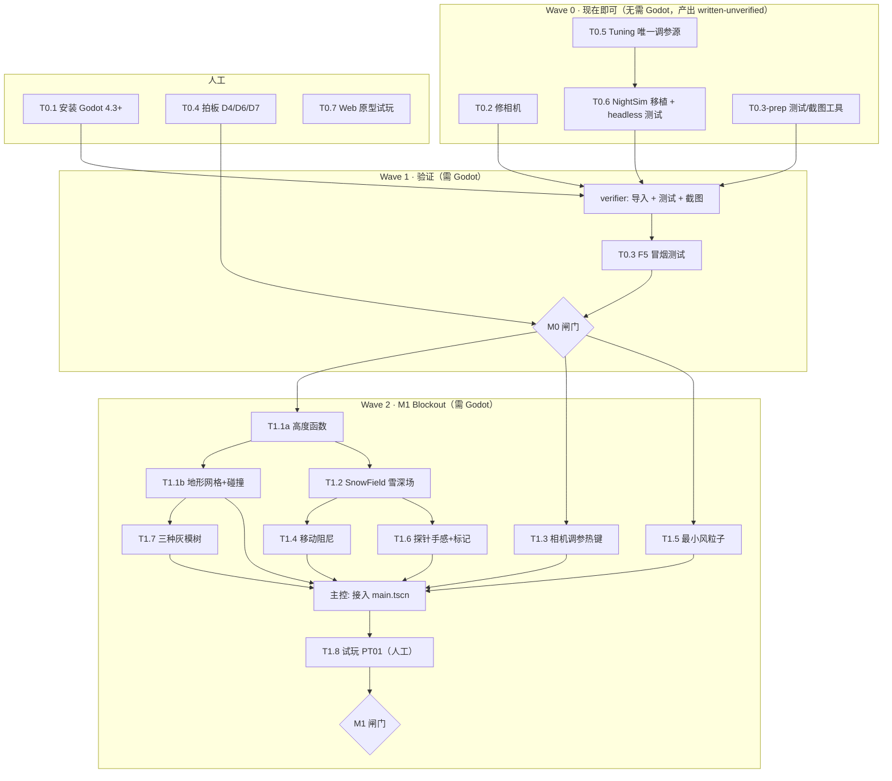

# CURRENT_STAGE.md — 当前施工合同

> **修订**：2026-10-05 · **当前里程碑**：M0 对齐与能跑 → M1 Blockout（只细化到 M1，过 M1 闸门后再细化 M2）
> **上游**：任务定义与闸门见 [`PRODUCTION_PLAN.md`](PRODUCTION_PLAN.md) §4；协作规则见 [`AGENTS.md`](AGENTS.md) §5–§7；状态投影见 [`progress.yaml`](progress.yaml)。
> 本文件只回答"**现在做什么、谁来做、按什么顺序、做到什么算完**"。

---

## 1. 现实基线（2026-10-05）

| 事实 | 影响 |
| :--- | :--- |
| 本机**没有 Godot**；工程骨架从未打开或运行过 | 所有代码任务上限为 `written-unverified`。**T0.1（人工安装）是全局关键路径** |
| `camera_rig.tscn` 中 `Camera3D` 位于 rig 原点、无偏移 | 正交相机近裁剪面大概率切掉角色（推断）→ T0.2 |
| `night_simulator.gd` 是 6 维评分，但没有倒棚分支，数值写在脚本内 | T0.5 + T0.6 |
| 探针读碰撞体 meta `snow_depth`，不是深度场 | M1 T1.2 改掉；M0 冒烟测试仍按 meta 读数验收 |
| 决策 D1/D2/D3/D5 已定；D4/D6/D7 待你拍板 | T0.4 未完全关闭；不阻塞 M0 代码任务，D6 阻塞"是否继续移植 Web 原型" |
| Web 原型 `references/20260919_fable5_mvp` 未能构建（npm 网络失败） | T0.7 需你在网络正常的环境做 |

---

## 2. 任务依赖图



**提前量上限**：Godot 未就绪时，只允许写 Wave 0 和 M1 中的**纯逻辑**（T1.1a、T1.2 的 `.gd` + 测试），不写任何新 `.tscn`。未验证代码堆得越多，第一次打开工程时排错越难。

---

## 3. 派发顺序与并行规则

| 波次 | 任务 | 执行者 | 可并行 | 前置 |
| :--- | :--- | :--- | :--- | :--- |
| 0 | T0.2 | godot-dev | ✅ 与 T0.5、T0.3-prep 并行（文件不相交） | — |
| 0 | T0.5 → T0.6 | godot-dev（同一个，串行） | ❌ T0.6 依赖 `tuning.gd` | — |
| 0 | T0.3-prep | godot-dev | ✅ | — |
| 0 | 回执审核 | 主控 | — | 以上 |
| 人工 | T0.1 / T0.4 / T0.7 | 你 | ✅ | — |
| 1 | 导入、语法检查、跑测试、截图 | verifier | ❌ 串行 | T0.1 + Wave 0 |
| 1 | T0.3 冒烟测试 | verifier + 你看截图 | — | 上一步 |
| 2a | T1.1a | godot-dev | — | M0 闸门 |
| 2b | T1.1b ‖ T1.2 ‖ T1.3 ‖ T1.5 | 最多 3 个 godot-dev | ✅ 文件不相交 | T1.1a（T1.3、T1.5 只需 M0） |
| 2c | T1.4 ‖ T1.6 ‖ T1.7 | godot-dev | ⚠️ T1.4 与 T1.6 都改 `player_controller.gd` → **串行** | T1.2 / T1.1b |
| 2d | 接入 `main.tscn` + 整体截图 | 主控 → verifier | ❌ | 2b–2c |
| 2e | T1.8 PT01 | 你 + 3 名测试者 | — | 2d |

**并行判据**：两张任务卡的 `Files` 无交集才可并行；`scenes/main.tscn`、`project.godot`（输入映射）只由主控修改。

---

## 4. 任务卡

> 格式固定。subagent 只能写 `Files` 列出的文件；需要改别的文件时在回执 `Deviations` 中说明，由主控决定。

### Wave 0

```text
Task:       T0.2 修相机
Read first: AGENTS.md §4.1, VISUAL_LANGUAGE.md 相机章节, scripts/camera/isometric_camera_rig.gd
Files:      scenes/camera/camera_rig.tscn, scripts/camera/isometric_camera_rig.gd
Depends:    —
Done when:  Camera3D 在 rig 内本地 +Z 偏移 40 m（偏移量与 size 改为 rig 脚本 @export，后续由 T0.5 接入 tuning）；
            near/far 保证 [0.05, 200+] 覆盖角色与 100 m 地图；rig 偏航 45°、俯仰 35.264° 保持不变；
            用三角函数手算说明角色位于画面中心（写进回执）
Do NOT:     改投影方式 / 加热键（属 T1.3）/ 改 main.tscn
Needs Godot: 验证需要；编写不需要 → 状态上限 written-unverified
```

```text
Task:       T0.5 唯一调参源
Read first: AGENTS.md §3.2–3.3, references/20260919_fable5_mvp/src/game/tune.ts, scripts/resources/wind_data.gd,
            CORE_GAMEPLAY.md（参数标签）, research/SNOW_SHELTER_RESEARCH.md
Files:      scripts/resources/tuning.gd (new, class_name Tuning extends Resource), resources/tuning.tres (new)
Depends:    —
Done when:  tune.ts 中与 MVP 相关的参数全部迁为 @export 并按组 (@export_group) 分类；
            每个字段注释带 [REAL]/[GAME]/[TUNE]；雪深门槛按 D5（0.3 / 0.9 / 1.0 / 1.5 / 2.0 m，顶厚 0.3 / 0.45 m）；
            风速单位统一 km/h；回执附"tune.ts 字段 → tuning.gd 字段"对照表及被丢弃字段与理由
Do NOT:     改其他脚本去引用它（T0.6 和后续任务负责接入）；照搬 Web 原型 0.72 / 0.95 m 门槛或篝火整夜加温
Needs Godot: 验证需要 → written-unverified
```

```text
Task:       T0.6 NightSimulator 移植 + 测试
Read first: CORE_GAMEPLAY.md §5–§6（6 维与倒棚表）, PRODUCTION_PLAN.md D2/D3/D5,
            references/20260919_fable5_mvp/src/game/nightSim.ts, scripts/systems/night_simulator.gd, scripts/resources/tuning.gd
Files:      scripts/systems/night_simulator.gd, tests/run_all.gd (new), tests/test_night_sim.gd (new)
Depends:    T0.5
Done when:  所有阈值/权重从 Tuning 读取（evaluate 接收 Tuning 参数或注入）；
            4 种预设 + None：RaisedCave / BasicCave / SnowTrench（含砌墙变体）/ LeanTo（反射火 + 备柴量 → 熄火时刻）；
            雪庇护所不接受"洞内火"输入，睡前篝火只修正入夜状态；
            输出 {scores: 6 项, notes: 每项一句归因, outcome: SAFE/COLD/DANGEROUS}；
            测试覆盖 ≥ 7 例：完美高床洞 / 无通风 / 入口迎风 / 无垫层 / 未完工 / 倒棚备柴足 / 倒棚备柴不足；
            run_all.gd 失败时 quit(1)
Do NOT:     做真实热力学；新增第 5 种预设；改 UI
Needs Godot: 跑测试需要 → written-unverified
```

```text
Task:       T0.3-prep 测试与截图工具
Read first: AGENTS.md §4「Godot 命令」
Files:      tools/capture_snapshot.gd (new)
Depends:    —
Done when:  extends SceneTree；加载 res://scenes/main.tscn，等待若干帧后保存
            get_root().get_viewport().get_texture().get_image() 到 --out 参数指定路径并退出；
            无 --out 时默认 snapshots/capture_<时间>.png
Do NOT:     依赖编辑器插件；在 headless 模式下声称能截图
Needs Godot: 验证需要 → written-unverified
```

### Wave 1（Godot 安装后）

```text
Task:       M0 验证（verifier）
Read first: AGENTS.md §4–§5, 本文件 §4 Wave 0 全部回执
Files:      AGENTS.md「Godot 命令」节（校准实际可用命令）, 回执
Steps:      1) godot --version 写进 README  2) --import，记录全部错误  3) --check-only 每个 .gd
            4) run_all.gd  5) capture_snapshot 截一张默认画面
Done when:  导入零错误；测试全绿；截图中角色居中、无裁切（主控 view 截图确认）
On failure: 回执列出错误原文与定位，不自行大改；单个文件的小修（≤ 10 行）可直接做并注明
```

```text
Task:       T0.3 F5 冒烟测试
Files:      回执；必要时 scenes/world/blockout_terrain.tscn
Done when:  WASD 移动方向与屏幕方向一致；探针坡上 ≈2.15 m、平地 ≈0.65 m；Output 零错误
Needs:      交互部分由你实际按 F5 确认（Agent 无法操作窗口），verifier 负责截图与日志
```

### Wave 2（M1，通过 M0 闸门后才派发）

| Task | Files（可写范围） | Done when（摘要，完整见 PRODUCTION_PLAN §4 M1） |
| :--- | :--- | :--- |
| T1.1a 高度函数 | `scripts/world/terrain_height.gd`, `tests/test_terrain.gd` | 纯函数 `height_at(x,z)`；布局：西迎风坡→脊线→东背风坡→平台→沟谷；测试断言脊线最高、东坡比西坡缓 |
| T1.1b 地形网格 | `scripts/world/terrain_builder.gd`, `scenes/world/terrain.tscn` | 由 T1.1a 生成 `ArrayMesh` + `HeightMapShape3D`；100 m 可走遍 |
| T1.2 雪深场 | `scripts/world/snow_field.gd`, `tests/test_snow_field.gd` | `snow_at/slope_at/lee_factor`；同一斜坡读数连续；背风区读数落在 D5 雪洞区间；分布满足"深雪处少木材" |
| T1.3 相机热键 | `isometric_camera_rig.gd`, `resources/tuning.tres` | size 14/18/24、pitch 35/38/42 切换；你选定后写入 tuning |
| T1.4 移动阻尼 | `player_controller.gd` | 上坡、深雪减速，系数来自 tuning |
| T1.5 最小风与避风感官 | `scenes/world/wind_particles.tscn`, `scripts/player/wind_exposure_sensor.gd`, `shaders/snow_terrain.gdshader` | 静帧可读风向；躲在树根/岩石背风侧风声低通滤波变闷、停止寒颤；雪面呈现冷暖色彩对比 |
| T1.6 探针手感 | `player.tscn`, `player_controller.gd`, `scripts/world/probe_marker.gd` | 按住 ≈0.85 s；查询 `SnowField`；地面持久标记 |
| T1.7 灰模树与树根掩体 | `scenes/world/tree_{spruce,standing_dead,fallen}.tscn` | 灰度截图可区分；翻倒树根（Root Ball）带避风碰撞体 |

---

## 5. 闸门、停止条件与回滚

| 闸门 | 通过条件 | 证据 |
| :--- | :--- | :--- |
| **M0** | Godot 导入零错误；`run_all.gd` 全绿；默认画面截图角色居中；D4/D6/D7 已拍板 | 测试输出、`snapshots/` 截图、PRODUCTION_PLAN §3 更新 |
| **M1** | PT01：≥ 2/3 测试者 30 秒内说出风向；首针落背风区；无人抱怨移动 | `snapshots/snapshot_01_blockout.png`、`playtests/PT01.md`、tag `m1-blockout` |

**停止条件**（subagent 立即停下并回报）：需要改 `Files` 以外的文件超过 10 行；需要新增资源类型、预设或系统；发现设计文档之间矛盾；同一错误修两次仍失败。
**回滚**：每个任务单独提交；验证失败时 `git revert` 该提交，不在失败基础上叠加修补。
**M1 没过**：只改相机、风、地形，不进 M2（PRODUCTION_PLAN §4）。

---

## 6. 下一次更新本文件的时机

- Wave 0 回执审完 → 更新 §1 基线；
- M0 闸门通过 → 删除 Wave 0/1 卡片，Wave 2 展开为完整任务卡；
- M1 闸门通过 → 本文件切换到 M2，并按 PT01 结论调整任务。
