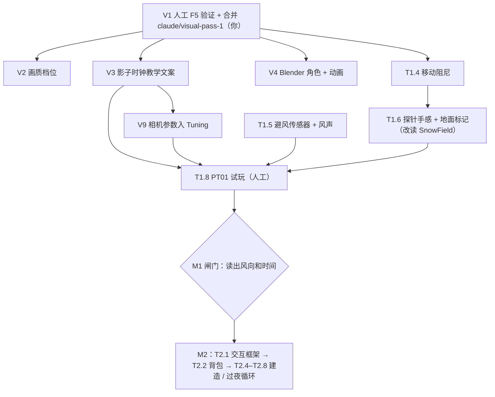
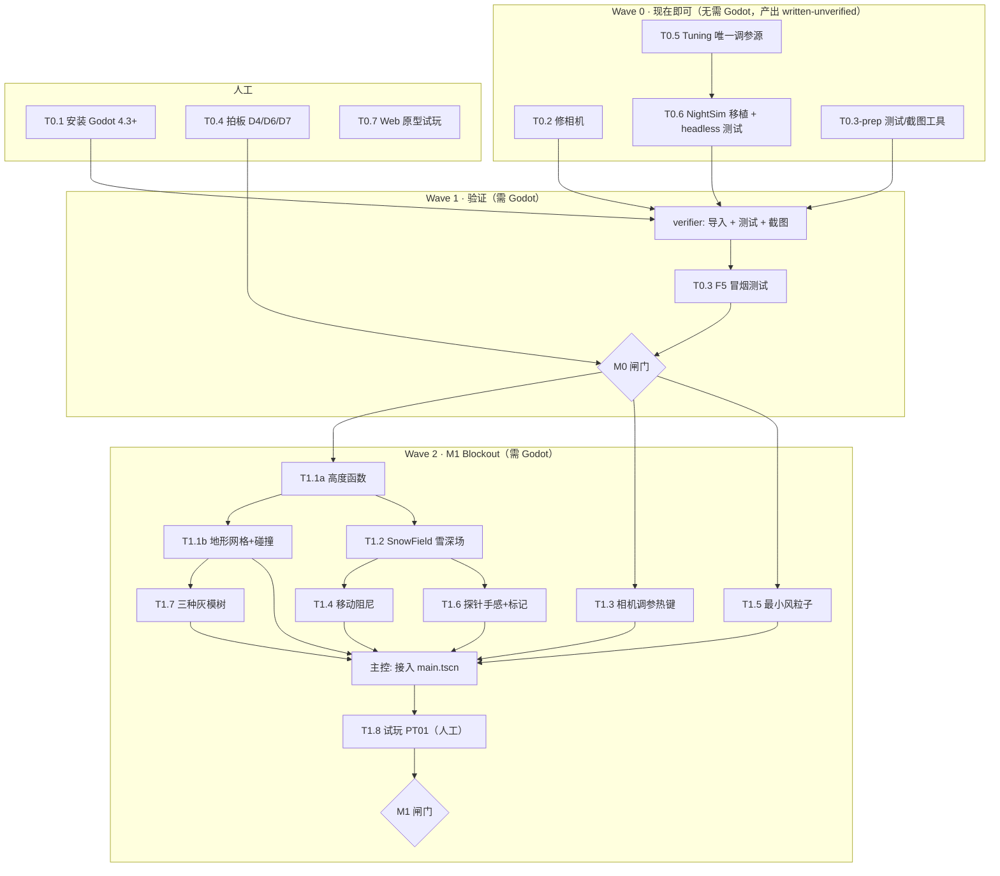

# CURRENT_STAGE.md — 当前施工合同

> **修订**：2026-11-01（晚）· **当前阶段**：M2 Playable 循环已完成（written-unverified）→ **D12 关卡阶梯（L 轨道）** → 关卡版人工试玩 PT01/PT02 → M3 内容与收尾
> **上游**：任务定义与闸门见 [`PRODUCTION_PLAN.md`](PRODUCTION_PLAN.md) §4（V 轨道在 §4.V）；协作规则见 [`AGENTS.md`](AGENTS.md) §5–§7；状态投影见 [`progress.yaml`](progress.yaml)。
> 本文件只回答"**现在做什么、谁来做、按什么顺序、做到什么算完**"。

---

## 0‴. 现阶段优先级（2026-11-01，用户定调）

> "**机制与正确的表现更重要**，现阶段专注这里。"——先保证规则按设计工作、画面 / 文案 / 报告如实反映本图真实状态（数字取实测），再谈打磨。审每个改动时先问：玩家看到的和规则算的是不是同一件事？

## 0⁵. D14 可玩的夜晚（2026-11-01，现在做）

旧夜晚是一次性公式结算，硬阈值让平衡没有容错（我在"窒息"与"冻死"之间来回调就是这个原因）。D14 把夜晚变成快进可玩的一段：体温曲线、黑暗、冷醒事件与夜间行动、**冻死前必醒一次**、结局按整夜最低体温。规则 `CORE_GAMEPLAY.md` §10，任务 `PRODUCTION_PLAN.md` §4.N。

**顺序**：N1 纯逻辑模型（先测试）→ N3 事件与行动 ‖ N2 播放与黑暗 → N4 报告 → N5 机器人与平衡 → 再回到 S5 其余庇护所（雪堆屋、岩檐、倒木斜棚）与 S7。

## 0⁗. D13 章节 / 庇护所 / 地形（2026-11-01，用户方向）

用户方向：5 章 × 10 阶；庇护所熬过一夜即学会、可回旧章节重玩；地形多样（起伏、树密度、湖岸、悬崖）；同章内难度 1–10；所有关卡有雪。规则 `CORE_GAMEPLAY.md` §9，任务 `PRODUCTION_PLAN.md` §4.S。

**用户已定（2026-11-01）**：①每阶默认固定一张图，玩家按 [N] 才换新图 ②第 5 阶通过即开下一章 ③新存档只会雪沟（现实中最容易的应急雪庇护所）④先做地形配方（S1）。
**仍待确认**：章节草案（§9.5）、新庇护所顺序（树井 → 雪堆屋 → 岩檐 → 倒木斜棚）。

**顺序**：S1 地形配方 → S2 地物规则摆放 → S6 装备 ‖ S4 庇护所学习 → S3 章 × 阶 → S5 新庇护所（逐个）→ S7 平衡 → S8 试玩。

## 0″. D12 关卡阶梯（2026-11-01，用户拍板，覆盖 §0′ 第 3 行的"不加系统"）

用户决定：单局结构改为 **5 关逐级提高难度 + 关内随机 + 通关后自由模式**（`PRODUCTION_PLAN.md` D12，规则 `CORE_GAMEPLAY.md` §8，任务 §4.L）。L 轨道可以在 PT01/PT02 之前施工；试玩直接试关卡版。

| 顺序 | 任务 | 执行者 | 说明 |
| :--- | :--- | :--- | :--- |
| 1 | L1 关卡数据 + 种子 | godot-dev | 先写测试 |
| 2 | L2 环境旋钮 ‖ L4 关卡选择与解锁 | godot-dev ×2 | L2 改 world 脚本，L4 改 UI / records，不冲突；`game_director.gd` 两边都改 → 主控合并 |
| 3 | L3 风向 = 整图旋转 | godot-dev | 风险最大；有 ±30° 抖动退路 |
| 4 | L5 课题文案 | godot-dev | EN + ZH |
| 5 | L6 关卡平衡 + CI | godot-dev → verifier | 每关 4 山谷 × 3 种子 |
| 6 | L7 试玩（关卡版 PT01/PT02） | 你 + 测试者 | 替代 §0′ 第 1–2 行的试玩内容 |

```text
Task:       L1 关卡数据
Read first: CORE_GAMEPLAY.md §8, ARCHITECTURE_GODOT.md §3.9
Files:      scripts/resources/level_def.gd (new), resources/levels/*.tres (new), scripts/systems/level_state.gd (new),
            tests/test_levels.gd (new), tests/run_all.gd
Depends:    —
Done when:  5 关 + 自由模式 .tres（数值按 §8.2，标 [GAME]/[TUNE]）；同种子抽取可复现；抽取落在本关范围；
            --level / --seed 解析；run_all 全绿
Do NOT:     改任何 world / UI 脚本（L2 / L4 的事）；手写 uid
Needs Godot: 是（headless 测试）
```

```text
Task:       L3 风向 = 整图旋转
Read first: CORE_GAMEPLAY.md §8.3, ARCHITECTURE_GODOT.md §3.9, AGENTS.md §4.1（相机红线）
Files:      terrain_height.gd, snow_field.gd, forest_scatter.gd, scenery_builder.gd, drift_scatter.gd, resource_spawner.gd,
            far_terrain_builder.gd（如需）, tests/test_terrain.gd
Depends:    L1, L2
Done when:  旋转在一处坐标转换完成；0/90/180/270° 截图各一张（树冠偏向、雪枕、背风深雪一致，罗盘风向正确，太阳不动）；
            旋转 0° 时所有现有测试与机器人结果不变；回执附 FPS
Do NOT:     改相机偏航（D8）；改太阳（D9）；改评分
Needs Godot: 是（截图需窗口）
```

---

## 0′. 最新进展（2026-11-01 晚，覆盖下方 §0 的顺序）

**已完成（scripted 打通三条路线，194 assertions 全绿；均为 written-unverified，待人工 F5）**：
T1.4 移动阻尼 · T1.6 探针 + 标记（D4 采纳默认）· T1.5 暴露度 + 风声 · T2.1–T2.11（除 PT02）· V2 画质档位 · V3 影子时钟提示 · V4 Blender 角色 · V5 边缘光 · V6 冰湖 · V8 脚印 · V9 相机入 Tuning · T3.1 树摆 / 降雪 · T3.7 报告 UI · T3.8 程序化音频 · T3.9 平衡（策略机器人）· 目标行 · 失温倒下 · 暂停菜单 · 头灯 · MVP #9 顶厚 / 通风选项 · 野外手册 [H] · 罗盘太阳 · 雪洞入夜小场景 · 最好记录。

**QA 工具**（改动后跑 `tools/ci.sh`，约 6 分钟；`--quick` 约 2 分钟）：`tests/run_all.gd`（453 断言）· `tools/input_smoke_test.gd`（真实输入 + 手柄 + 重开）· `tools/playtest_bot.gd`（平衡）· `tools/fuzz_test.gd`（随机输入，多种子）。已知：偶发引擎原生崩溃约 2%（见 todo.md），已用启动守卫从约 8% 降下来。

**夜雪堵通风**：入睡时降雪 ≥ 0.5 且只有一根通风管、没插木棍 → 空气分封顶 55（COLD 级，不致命）；完工后目标行提示插木棍（1 木）。

**平衡基线**（`godot --path . -s res://tools/playtest_bot.gd -- --s=<策略>`，2026-11-01 R1 后）：深雪高床洞 + 树根盘背风处生火烘干 + 通风木棍（deep_stick）/ 两根通风管（twovent）= SAFE；good / deep / quick（降雪堵通风）= COLD（最弱 Air）；雪沟（烘干）/ 倒棚 = COLD；入口迎风 / 开工太晚 / 露天 = DANGEROUS。挖雪庇护所后不烘干就睡 = 湿衣，Heat −35%。改 Tuning 后重跑。

**现在做什么**

| 顺序 | 任务 | 执行者 | 说明 |
| :--- | :--- | :--- | :--- |
| 1 | **F5 试玩一整局**（V1 + T0.3）并合并分支 | 你 | 按 README 的按键说明；记录卡住 / 不明白的地方 |
| 2 | PT01 + PT02 合并试玩（3 人，各一局） | 你 + 测试者 | 闸门：能完整打完、能说出风向与"为什么是这个结果"、愿意再玩 |
| 3 | 按试玩结果只调 Tuning 与文案（不加系统） | Agent | M2 闸门规则 |
| 4 | M3：已无 Agent 可独立完成的剩余项（天气多样性已做：晴 / 阴 / 暴风雪将至，测试用 `-- --weather=<kind>`） | — | — |
| 5 | T4.5 标题画面打磨；T4.4 世界内雪洞内饰；导出构建（需下载导出模板，需你授权） | Agent + 你 | M4 |

---

## 0. 现在做什么（2026-11-01）



| 顺序 | 任务 | 执行者 | 可并行 | 说明 |
| :--- | :--- | :--- | :--- | :--- |
| 1 | **V1** F5 验证 + 合并分支 | 你（Agent 可协助推送 / 开 PR） | — | 视觉三轮都是 written-unverified，必须先过人工 |
| 2 | V2 ‖ V3 ‖ T1.4，V9 排在 V3 之后 | godot-dev ×3 | ⚠️ V3 与 V9 都改 `tuning.gd` → 串行；V2 独占 `project.godot` | |
| 3 | T1.6（在 T1.4 之后，同改 `player_controller.gd`）‖ T1.5 | godot-dev | ⚠️ T1.6 与 T1.4 串行 | |
| 3 | V4 角色 | Blender + godot-dev | ✅ 独占 `player.tscn` / `hiker_visual.gd` | 用户已授权使用 Blender |
| 4 | 主控合并 + verifier 截图 + FPS | 主控 → verifier | ❌ | 截图：`snapshots/visual_pass4_*.png`，附 FPS |
| 5 | T1.8 PT01 | 你 + 3 人 | — | 闸门第②问含"能否说出大致时间" |
| 之后 | M2（T2.1 起） | — | — | 过 M1 闸门后再细化任务卡 |

**暂缓**：V5–V8（可读性、冰湖、AtmosphereState、脚印）在 M2 循环跑通前只在空档插做。

### 本阶段任务卡

```text
Task:       V2 画质档位
Read first: PRODUCTION_PLAN.md D11 / §4.V, ARCHITECTURE_GODOT.md §3.6
Files:      scripts/systems/graphics_settings.gd (new), project.godot, scripts/world/atmosphere_setup.gd, scripts/world/far_terrain_builder.gd
Depends:    V1
Done when:  低 / 中 / 高 三档（渲染缩放、SSAO、DOF、泛光、阴影距离、远景林密度）；F 键或设置菜单切换并持久化；
            回执附三档在本机 1080p 的 FPS（用 RenderingServer 测 GPU ms），"低"档 ≥ 30 fps
Do NOT:     删除视觉特性；改相机构图
Needs Godot: 是
```

```text
Task:       V3 影子时钟教学
Read first: PRODUCTION_PLAN.md §2 第 5 条 / D9, VISUAL_LANGUAGE.md §2.2, scripts/systems/sun_model.gd
Files:      scripts/ui/tips.gd (new), scripts/ui/hud_controller.gd, scripts/systems/night_simulator.gd（仅归因文案）,
            scripts/resources/tuning.gd, resources/tuning.tres（新增 Tips 组）, tests/test_tips.gd (new)
Depends:    V1
Done when:  环境卡提示行按太阳高度 / 剩余日照切换 ≥ 3 句（例："Shadows are lengthening — about 1 h of light left."）；
            文案阈值来自 Tuning（[GAME]）；报告"开工太晚"归因提到影长；tests 覆盖阈值选择
Do NOT:     加新 UI 面板；在画面上画影子刻度
Needs Godot: 逻辑测试不需要；截图需要
```

```text
Task:       V4 角色（Blender）
Read first: ARCHITECTURE_GODOT.md §4.1（char_survivor 规格）, VISUAL_LANGUAGE.md §2.3, snapshots/snapshot_00_visual_north_star.png
Files:      assets/models/char_survivor.glb (new), assets/source/char_survivor.blend (new), scenes/player/player.tscn, scripts/player/hiker_visual.gd
Depends:    V1
Done when:  约 2k 三角面；红背包 + 黄防潮垫 + 黑白刻度探针；idle / walk / probe / dig 4 段动画，walk 与 move_speed 匹配；
            默认机位截图里角色轮廓可读；导入零警告
Do NOT:     改碰撞体尺寸；改 player_controller 移动逻辑
Needs Godot: 是（+ Blender）
```

```text
Task:       V9 相机参数定稿入 Tuning（替代 T1.3）
Read first: VISUAL_LANGUAGE.md §1, scripts/camera/isometric_camera_rig.gd
Files:      scripts/resources/tuning.gd, resources/tuning.tres, scripts/camera/isometric_camera_rig.gd
Depends:    V1, V3（同改 tuning.gd）
Done when:  fov / lens_shift / distance / player_screen_y / zoom 范围 / 偏航 迁入 Tuning `Camera` 组（[TUNE]）；
            开发热键 F6/F7 循环 2–3 组候选并在截图中对比；选定值入档
Do NOT:     改投影方案；改正交备用模式默认值
Needs Godot: 是
```

T1.4 / T1.5 / T1.6 / T1.8 任务卡见下方 §4 Wave 2（原文仍有效；T1.6 的探针改读 `SnowField`）。

---

## 1. 现实基线（2026-11-01）

| 事实 | 影响 |
| :--- | :--- |
| Godot 4.3 stable 已安装（`/home/bobbik/.local/bin/godot`），Vulkan Forward+ 可实机截图 | 代码任务可以真正验证；但"人工 F5 试玩"仍未做 → 状态上限多为 written-unverified |
| 6 套 headless 测试 164 assertions 全绿（night_sim / terrain / snow_field / warmth / shelter_builder / sun_model） | 新逻辑继续走测试先行 |
| 视觉三轮在分支 `claude/visual-pass-1`，**未合并 master、未推送** | V1 |
| 默认相机已改为移轴透视（D8），太阳走真实日轨（D9） | 文档已同步；T1.3 → V9；T3.3 作废 |
| 探针仍读碰撞体 meta `snow_depth`，不是深度场 | T1.6 |
| 本机 UHD 620 @1080p 约 13 FPS | V2 / D11 |
| 交互、背包、建造按键、过夜报告 UI 都未接 | M2 主体工作 |
| D4 / D6 / D7 / D10 / D11 待你拍板 | 不阻塞 V / M1 |

> 以下 §2–§6 是 2026-10-05 制定的 M0 / M1 施工合同，保留作历史与 M1 剩余任务卡来源；与 §0 冲突时以 §0 为准。

---

## 2. 任务依赖图（2026-10-05 版，历史）



**提前量上限**：Godot 未就绪时，只允许写 Wave 0 和 M1 中的**纯逻辑**（T1.1a、T1.2 的 `.gd` + 测试），不写任何新 `.tscn`。未验证代码堆得越多，第一次打开工程时排错越难。

---

## 3. 派发顺序与并行规则

| 波次 | 任务 | 执行者 | 可并行 | 前置 |
| :--- | :--- | :--- | :--- | :--- |
| 0 | T0.2 | godot-dev | ✅ 与 T0.5、T0.3-prep 并行（文件不相交） | — |
| 0 | T0.5 → T0.6 | godot-dev（同一个，串行） | ❌ T0.6 依赖 `tuning.gd` | — |
| 0 | T0.3-prep | godot-dev | ✅ | — |
| 0 | 回执审核 | 主控 | — | 以上 |
| 人工 | T0.1 / T0.4 / T0.7 | 你 | ✅ | — |
| 1 | 导入、语法检查、跑测试、截图 | verifier | ❌ 串行 | T0.1 + Wave 0 |
| 1 | T0.3 冒烟测试 | verifier + 你看截图 | — | 上一步 |
| 2a | T1.1a | godot-dev | — | M0 闸门 |
| 2b | T1.1b ‖ T1.2 ‖ T1.3 ‖ T1.5 | 最多 3 个 godot-dev | ✅ 文件不相交 | T1.1a（T1.3、T1.5 只需 M0） |
| 2c | T1.4 ‖ T1.6 ‖ T1.7 | godot-dev | ⚠️ T1.4 与 T1.6 都改 `player_controller.gd` → **串行** | T1.2 / T1.1b |
| 2d | 接入 `main.tscn` + 整体截图 | 主控 → verifier | ❌ | 2b–2c |
| 2e | T1.8 PT01 | 你 + 3 名测试者 | — | 2d |

**并行判据**：两张任务卡的 `Files` 无交集才可并行；`scenes/main.tscn`、`project.godot`（输入映射）只由主控修改。

---

## 4. 任务卡

> 格式固定。subagent 只能写 `Files` 列出的文件；需要改别的文件时在回执 `Deviations` 中说明，由主控决定。

### Wave 0

```text
Task:       T0.2 修相机
Read first: AGENTS.md §4.1, VISUAL_LANGUAGE.md 相机章节, scripts/camera/isometric_camera_rig.gd
Files:      scenes/camera/camera_rig.tscn, scripts/camera/isometric_camera_rig.gd
Depends:    —
Done when:  Camera3D 在 rig 内本地 +Z 偏移 40 m（偏移量与 size 改为 rig 脚本 @export，后续由 T0.5 接入 tuning）；
            near/far 保证 [0.05, 200+] 覆盖角色与 100 m 地图；rig 偏航 45°、俯仰 35.264° 保持不变；
            用三角函数手算说明角色位于画面中心（写进回执）
Do NOT:     改投影方式 / 加热键（属 T1.3）/ 改 main.tscn
Needs Godot: 验证需要；编写不需要 → 状态上限 written-unverified
```

```text
Task:       T0.5 唯一调参源
Read first: AGENTS.md §3.2–3.3, references/20260919_fable5_mvp/src/game/tune.ts, scripts/resources/wind_data.gd,
            CORE_GAMEPLAY.md（参数标签）, research/SNOW_SHELTER_RESEARCH.md
Files:      scripts/resources/tuning.gd (new, class_name Tuning extends Resource), resources/tuning.tres (new)
Depends:    —
Done when:  tune.ts 中与 MVP 相关的参数全部迁为 @export 并按组 (@export_group) 分类；
            每个字段注释带 [REAL]/[GAME]/[TUNE]；雪深门槛按 D5（0.3 / 0.9 / 1.0 / 1.5 / 2.0 m，顶厚 0.3 / 0.45 m）；
            风速单位统一 km/h；回执附"tune.ts 字段 → tuning.gd 字段"对照表及被丢弃字段与理由
Do NOT:     改其他脚本去引用它（T0.6 和后续任务负责接入）；照搬 Web 原型 0.72 / 0.95 m 门槛或篝火整夜加温
Needs Godot: 验证需要 → written-unverified
```

```text
Task:       T0.6 NightSimulator 移植 + 测试
Read first: CORE_GAMEPLAY.md §5–§6（6 维与倒棚表）, PRODUCTION_PLAN.md D2/D3/D5,
            references/20260919_fable5_mvp/src/game/nightSim.ts, scripts/systems/night_simulator.gd, scripts/resources/tuning.gd
Files:      scripts/systems/night_simulator.gd, tests/run_all.gd (new), tests/test_night_sim.gd (new)
Depends:    T0.5
Done when:  所有阈值/权重从 Tuning 读取（evaluate 接收 Tuning 参数或注入）；
            4 种预设 + None：RaisedCave / BasicCave / SnowTrench（含砌墙变体）/ LeanTo（反射火 + 备柴量 → 熄火时刻）；
            雪庇护所不接受"洞内火"输入，睡前篝火只修正入夜状态；
            输出 {scores: 6 项, notes: 每项一句归因, outcome: SAFE/COLD/DANGEROUS}；
            测试覆盖 ≥ 7 例：完美高床洞 / 无通风 / 入口迎风 / 无垫层 / 未完工 / 倒棚备柴足 / 倒棚备柴不足；
            run_all.gd 失败时 quit(1)
Do NOT:     做真实热力学；新增第 5 种预设；改 UI
Needs Godot: 跑测试需要 → written-unverified
```

```text
Task:       T0.3-prep 测试与截图工具
Read first: AGENTS.md §4「Godot 命令」
Files:      tools/capture_snapshot.gd (new)
Depends:    —
Done when:  extends SceneTree；加载 res://scenes/main.tscn，等待若干帧后保存
            get_root().get_viewport().get_texture().get_image() 到 --out 参数指定路径并退出；
            无 --out 时默认 snapshots/capture_<时间>.png
Do NOT:     依赖编辑器插件；在 headless 模式下声称能截图
Needs Godot: 验证需要 → written-unverified
```

### Wave 1（Godot 安装后）

```text
Task:       M0 验证（verifier）
Read first: AGENTS.md §4–§5, 本文件 §4 Wave 0 全部回执
Files:      AGENTS.md「Godot 命令」节（校准实际可用命令）, 回执
Steps:      1) godot --version 写进 README  2) --import，记录全部错误  3) --check-only 每个 .gd
            4) run_all.gd  5) capture_snapshot 截一张默认画面
Done when:  导入零错误；测试全绿；截图中角色居中、无裁切（主控 view 截图确认）
On failure: 回执列出错误原文与定位，不自行大改；单个文件的小修（≤ 10 行）可直接做并注明
```

```text
Task:       T0.3 F5 冒烟测试
Files:      回执；必要时 scenes/world/blockout_terrain.tscn
Done when:  WASD 移动方向与屏幕方向一致；探针坡上 ≈2.15 m、平地 ≈0.65 m；Output 零错误
Needs:      交互部分由你实际按 F5 确认（Agent 无法操作窗口），verifier 负责截图与日志
```

### Wave 2（M1，通过 M0 闸门后才派发）

| Task | Files（可写范围） | Done when（摘要，完整见 PRODUCTION_PLAN §4 M1） |
| :--- | :--- | :--- |
| T1.1a 高度函数 | `scripts/world/terrain_height.gd`, `tests/test_terrain.gd` | 纯函数 `height_at(x,z)`；布局：西迎风坡→脊线→东背风坡→平台→沟谷；测试断言脊线最高、东坡比西坡缓 |
| T1.1b 地形网格 | `scripts/world/terrain_builder.gd`, `scenes/world/terrain.tscn` | 由 T1.1a 生成 `ArrayMesh` + `HeightMapShape3D`；100 m 可走遍 |
| T1.2 雪深场 | `scripts/world/snow_field.gd`, `tests/test_snow_field.gd` | `snow_at/slope_at/lee_factor`；同一斜坡读数连续；背风区读数落在 D5 雪洞区间；分布满足"深雪处少木材" |
| T1.3 相机热键 | `isometric_camera_rig.gd`, `resources/tuning.tres` | size 14/18/24、pitch 35/38/42 切换；你选定后写入 tuning |
| T1.4 移动阻尼 | `player_controller.gd` | 上坡、深雪减速，系数来自 tuning |
| T1.5 最小风与避风感官 | `scenes/world/wind_particles.tscn`, `scripts/player/wind_exposure_sensor.gd`, `shaders/snow_terrain.gdshader` | 静帧可读风向；躲在树根/岩石背风侧风声低通滤波变闷、停止寒颤；雪面呈现冷暖色彩对比 |
| T1.6 探针手感 | `player.tscn`, `player_controller.gd`, `scripts/world/probe_marker.gd` | 按住 ≈0.85 s；查询 `SnowField`；地面持久标记 |
| T1.7 灰模树与树根掩体 | `scenes/world/tree_{spruce,standing_dead,fallen}.tscn` | 灰度截图可区分；翻倒树根（Root Ball）带避风碰撞体 |

---

## 5. 闸门、停止条件与回滚

| 闸门 | 通过条件 | 证据 |
| :--- | :--- | :--- |
| **M0** | Godot 导入零错误；`run_all.gd` 全绿；默认画面截图角色居中；D4/D6/D7 已拍板 | 测试输出、`snapshots/` 截图、PRODUCTION_PLAN §3 更新 |
| **M1** | PT01：≥ 2/3 测试者 30 秒内说出风向；首针落背风区；无人抱怨移动 | `snapshots/snapshot_01_blockout.png`、`playtests/PT01.md`、tag `m1-blockout` |

**停止条件**（subagent 立即停下并回报）：需要改 `Files` 以外的文件超过 10 行；需要新增资源类型、预设或系统；发现设计文档之间矛盾；同一错误修两次仍失败。
**回滚**：每个任务单独提交；验证失败时 `git revert` 该提交，不在失败基础上叠加修补。
**M1 没过**：只改相机、风、地形，不进 M2（PRODUCTION_PLAN §4）。

---

## 6. 下一次更新本文件的时机

- Wave 0 回执审完 → 更新 §1 基线；
- M0 闸门通过 → 删除 Wave 0/1 卡片，Wave 2 展开为完整任务卡；
- M1 闸门通过 → 本文件切换到 M2，并按 PT01 结论调整任务。
