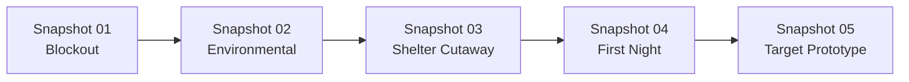

# VISUAL_LANGUAGE.md — 视觉与摄像机规则

> **视觉北极星 (Visual North Star v0.1)**  
> 详见概念设计资产：[`snapshots/snapshot_00_visual_north_star.png`](file:///d:/OneDrive/Learning/Code/Gemini/wild/snapshots/snapshot_00_visual_north_star.png)（原稿：[`design_assets/Codex Image Sep 12, 2026, 03_30_15 PM.png`](file:///d:/OneDrive/Learning/Code/Gemini/wild/design_assets/Codex%20Image%20Sep%2012,%202026,%2003_30_15%20PM.png)）

---

## 1. 摄像机核心参数 (The Orthographic 45° ISO)

本项目正式确立采用 **正交 45° 等距视角 (Orthographic 45° Isometric)**：

```text
Camera Type:          Orthographic (无透视消失点，平行投影)
Horizontal Rotation:  45° (固定的对角对方位角，保证对角线方阵平衡)
Vertical Pitch:       35° – 45° (视感可微调区间，不被纯数学 35.264° 锁死)
Clipping / Cutaway:   支持沿地形/雪洞壁平滑做剖面切削（Cutaway View）
```

### 为什么选择正交 45° ISO？
1. **美术资产生产极其友好**：同一棵松树、同一块岩石，只要旋转 90°/180° 或水平镜像，即可直接复用，完全无透视形变。
2. **空间与尺寸绝对精准**：雪坡倾角、雪洞壁厚、积雪深度、移动距离等在屏幕上呈现恒定像素比例，方便玩家进行“空间工程规划”。
3. **内外视角无缝切换**：当展示雪洞内部时，正交剖面（Cutaway）与外部雪坡能维持在同一视觉体系下，无需切换第一人称或破坏沉浸感。
4. **极利于前期原型验证**：无论是 Low-Poly、灰模方块、还是手绘平贴图，都能自然融合，避免前期陷入昂贵的 3D 拟真模型泥潭。
5. **符合核心玩法心流**：我们做的是**“观察 + 规划 + 决断”**，上帝正交视角让玩家像一位冷静的雪原勘测工程师。

---

## 2. 色彩与光影哲学 (Palette & Lighting)

```text
       [环境基底]                             [庇护所 / 能量核心]
   蓝 (Deep Navy)                         暖橙 (Amber / Flame)
   灰 (Storm Grey)         ─────── VS ───────      暖金 (Sunset Gold)
   白 (Glacial White)                       烛光白暖 (Warm Glow)
  (压迫、肃杀、广袤)                           (安全、生机、喘息)
```

1. **环境色调（80% 视觉占比）**：
   - 以低饱和度蓝、冷灰、雪白为绝对主色调。
   - 阴影偏深紫冷蓝，迎光面偏冷青白。
2. **光源色调（20% 强调点睛）**：
   - 暖色只在三种情况下出现：
     - **低角度冬日落日**（在雪原上拉出长长的金色斜阳）；
     - **点燃的火柴、蜡烛、火塘**（雪洞切片中那一团微弱但顽强的琥珀色）；
     - **提灯 / 探针高亮**。
3. **对比感强化**：
   - 外部越是风雪交加、昏暗青蓝，雪洞内部的橙色烛光就越令人心安。

---

## 3. 极简 UI 与去游戏化表现 (Minimal HUD)

- **World-Space Information (让世界本身传达信息)**：
  - 不做悬浮的风向箭头 UI —— 玩家通过**空中狂吹的雪尘、剧烈摇摆的树梢**判断风向风速。
  - 不做夸张的头顶血条 —— 玩家通过**角色呼吸哈出的白汽频率、行走颤抖动作**感知体温。
  - 不做艳俗的拾取物描边 —— 枯木本身有泛灰脱皮的材质区分，仅在光标移上时给予极其内敛的**浅琥珀色微弱描边 (Subtle Warm Highlight)**。
- **Screen HUD**：
  - 仅保留极小巧的怀表/日照刻度指示，以及探针插下时弹出的极简技术标尺。

---

## 4. 视觉里程碑制度 (Development Snapshot System)

> **原则**：拒绝“闭门写两个月代码，却连游戏长什么样都看不到”。  
> 每完成一个关键阶段，**必须产出一张全分辨率实机截图/渲染快照**，归档进 `snapshots/`。



### 里程碑快照定义表：

| 快照编号 | 里程碑名称 | 画面中必须呈现的要素 | 验证的核心问题 |
| :--- | :--- | :--- | :--- |
| **Snapshot 01** | **Blockout** | 白色地形高低坡、纯灰模型树、橙色胶囊人体、45° ISO 基础镜头 | 地图比例、坡度感与角色移动感是否舒适？ |
| **Snapshot 02** | **Environmental Reading** | 粒子风雪（有明确吹向）、落日光照与长阴影、立枯木对比、探针插地读数 | 玩家光看画面能否直接读出风向和枯木？ |
| **Snapshot 03** | **Shelter Cutaway** | 雪坡上的洞口、剖开的雪洞内部高低床结构、通向外部的通气管 | 剖面透视与外部世界的衔接是否直观自然？ |
| **Snapshot 04** | **First Night** | 夜间狂暴风雪特效、洞内一缕温暖火光、半透明结算报告卡片 | 是否实现了 *Brutal Outside, Cozy Inside*？ |
| **Snapshot 05** | **Target Prototype** | 材质、雪面脚印、树枝积雪、雾气光晕完全就绪的垂直切片画面 | 是否达到甚至超越了 Visual North Star v0.1？ |
