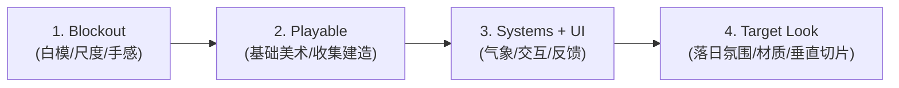

# VISUAL_LANGUAGE.md — 视觉与摄像机规则

> **视觉北极星 (Visual North Star v0.1)**  
> 详见概念设计资产：[`snapshots/snapshot_00_visual_north_star.png`](file:///d:/OneDrive/Learning/Code/Gemini/wild/snapshots/snapshot_00_visual_north_star.png)（原稿：[`design_assets/Codex Image Sep 12, 2026, 03_30_15 PM.png`](file:///d:/OneDrive/Learning/Code/Gemini/wild/design_assets/Codex%20Image%20Sep%2012,%202026,%2003_30_15%20PM.png)）

---

## 1. 摄像机核心参数（移轴透视，2026-11-01 起，决策 D8）

> 用户拍板："north star 的表现力优先于 45° 正交的省事"。正交等距保留为备用模式（运行时 **V** 键）。

```text
默认模式:   TILT_SHIFT（Camera3D.PROJECTION_FRUSTUM，离轴视锥 = 移轴镜头）
光轴俯仰:   -21.5°（2026-11-04 用户试玩后拍板，总俯角 35°：看得远、林子里能看到地面；代价是地平线与落日出画、竖线略有汇聚。之前是 0° / 13.5°，再之前试过 24°）
镜头下移:   lens_shift = -0.38（占半高；把画面窗口下移去看地面，天际线留在上沿）
垂直视场:   48°
偏航:       135°（镜头朝西南 = 1 月午后太阳的真实方位，见 §2.2）
距离:       28 m × 缩放（滚轮 0.45–2.6；近 = 建造，远 = 侦察）
玩家位置:   画面自上而下 58 % 处（由 lens_shift 与 fov 反算相机抬高角）
景深:       焦平面在玩家处，前后柔和虚化（微缩感）；性能档位可关
备用模式:   ORTHO：俯仰 -38°、size 18–30、far 200
```

所有参数为 `[TUNE]`，目前是 `isometric_camera_rig.gd` 的 `@export`，定稿后迁入 Tuning（V9）。

### 为什么从正交改为移轴透视？
1. **天际线与落日常驻画面**：正交俯视永远看不到地平线和太阳；而时间（§2.2）与远景山谷是这款游戏的核心情绪与信息来源。
2. **保留正交的优点**：光轴水平 → 竖线不汇聚，构图依旧像整洁的等距沙盘；资产仍可旋转 / 镜像复用。
3. **深度线索更强**：透视 + 景深 + 大气透视让"读地形"（坡度、远近）比正交更容易（M1 风险项）。

### 相机相关的硬规则
- **不得写死偏航角**：玩家输入（`player_controller.gd`）与罗盘（`compass_rose.gd`）一律从当前相机朝向推导。
- **遮挡镂空**：挡在玩家前方的树（`snow_cover.gdshader` 的 `occlusion_fade`）按 4×4 Bayer 抖动镂空；阴影 pass 不镂空。新增的高大遮挡物材质也要支持。
- **天空修正**：Godot 绘制天空背景时忽略 `frustum_offset`，相机 rig 每帧把真实镜头参数推给 `sky_backdrop.gdshader`（`lens_receivers` 组）。
- **出生点视野**：出生点朝远景方向保留稀疏走廊，相机一侧保留空地。


### 地形挡视线时抬高机位（2026-11-03，第四次评审后）

机位俯角约 35°，比这更陡的坡会挡住玩家，推近也没用。此时机位绕玩家抬高（`BuildSession.view_lift`，上限 `tilt_lift_max_deg`；视线还是 13.5° 时全部章节实测最多 21°，改 24° 后未重测）：偏航、距离、玩家屏幕位置不变，平时为 0，竖线不汇聚的构图不变；只在抬高期间竖线略有汇聚。贴着镜头的树按到主体距离的比例镂空（`snow_cover.gdshader`）。

### 火的范围（2026-11-03 用户试玩后）

火只有一条规则：站进光圈。地上的光圈就是真实取暖半径（`fire_warm_radius_m`），圈内自动取暖、**F** 添柴、按住 **E** 喝热水，三者同一个距离。选中高亮小圈只表示"这是你要操作的东西"，不是范围，所以火不画它。光圈顶点取真实碰撞面（`height_at` 与粗网格在坡上会差出几十厘米）。

### 进入庇护所（2026-11-04 用户方向）

完工的庇护所可以走进去（按住 **E**：Enter the shelter）。换成 `ShelterInterior` 剖面（用户指定：对标 north star 右上角 SHELTER DESIGN，不用第一人称）：沿入口轴线切开，只画后面一半，切面上是厚雪壁，里面是空腔，人躺在里面，入口在屏幕左边，带标注；七种庇护所各有自己的结构。外面的世界照常。纯外观：体温本来就按人在不在里面算，规则没变。在里面可以睡觉；**E** / **B** 走出去。切面朝镜头一侧的树、枯木、石头用 `snow_cover.gdshader` 的 `section_*` 切掉（切面再往后退 `section_cut_behind_m`，工地本身那棵树也去掉，背景干净）；挡在前面的火堆暂时藏起来。**树井建造特写**同样切掉那棵老云杉朝镜头的一半（2026-11-07 C1/C2 试玩报告 P0：之前特写和剖面几乎全被枝条挡住）。

### 建造特写镜头（Build Focus，D16，2026-11-02 用户方向）

> **状态**：已实现（B1–B2，2026-11-02）。规则见 `CORE_GAMEPLAY.md` §12。证据 `snapshots/b1_focus_*.png`（1280×720，软件渲染；FPS 未在真实显卡上测）。

- **触发**：确认工地后自动进入；在未完工工地旁按 `E` / `B` 重新进入；`B` / `Esc` 退回远景。移动在特写内锁定，退回后恢复。
- **镜头语言**：只做“以工地为目标 + dolly-in + 平滑过渡”，不改变 D8 的移轴透视、135° 偏航、真实太阳与天际线。正交备用模式也必须可用。
- **构图主体是工地**：工地（入口 + 当前施工面）在画面中占主要位置；需要按庇护所体量设置不同的特写距离（雪沟 / 树井更近，雪洞稍远，倒棚居中）。
- **角色不得遮住工地**：玩家、背包、雪铲、手部动作不能覆盖工地入口或当前施工面。特写时把角色模型画在工地旁边、面向工地干活；万一仍与工地屏幕包围盒相交才半透明，不完全隐藏——**只影响外观，不改碰撞、位置和控制**，退出特写后恢复。
- **遮挡处理**：树井 / 密林 / 雪沟必须做相机与树冠、树干、地形的避让；`occlusion_fade` 的焦点在特写时切到工地，而不是玩家。
- **HUD**：特写内只保留建造面板（阶段、材料、工时、剩余天光、`B Step back & gather`）与必要的体温 / 时间信息；探索级世界标签隐藏。
- **远景回退**：未完工工地用固定 HUD 卡 + 世界内环 / 箭头标记，不使用压住工地的文字卡；世界标签继续遵守优先级、屏幕空间避让和 720p 最多 2 张的规则。

---

## 2. 色彩与光影哲学 (Palette & Lighting)

```text
       [环境基底]                             [庇护所 / 能量核心]
   蓝 (Deep Navy)                         暖橙 (Amber / Flame)
   灰 (Storm Grey)         ─────── VS ───────      暖金 (Sunset Gold)
   白 (Glacial White)                       烛光白暖 (Warm Glow)
  (压迫、肃杀、广袤)                           (安全、生机、喘息)
```

1. **环境色调（80% 视觉占比）**：
   - 以低饱和度蓝、冷灰、雪白为绝对主色调。
   - 阴影偏深紫冷蓝，迎光面偏冷青白。
2. **光源色调（20% 强调点睛）**：
   - 暖色只在三种情况下出现：
     - **低角度冬日落日**（在雪原上拉出长长的金色斜阳）；
     - **倒棚前的反射火**（开放庇护所的主要暖光）与**雪洞内的烛灯**（醒着时的一小团琥珀色，入睡熄灭）；
     - **提灯 / 探针高亮**。
3. **对比感强化**：
   - 外部越是风雪交加、昏暗青蓝，庇护所里的那一点暖光就越令人心安。

### 2.1 天空与远景（2026-11-01 修订，替代原 Canvas 背景层方案）

| 项目 | 规则 |
| :--- | :--- |
| 实现 | 真实 `Sky` + `sky_backdrop.gdshader`：天顶 → 地平线渐变，朝太阳一侧地平线偏暖、背向一侧偏冷；太阳圆盘 + 光晕 |
| 远景 | `FarTerrainBuilder`：100 m 地图外一圈无碰撞远景。相机正前方（西南）是下跌约 38 m 的山谷，远山压低让太阳落在山脊上方；两侧高山框住画面；林线以下铺低面数远景林 |
| 反映时间 | 太阳方向来自 `SunModel`（§2.2）。日落前地平线暖带加浓；日落后整体转入暮蓝 → 夜色；环境光与雾强度随太阳高度变化 |
| 反映天气 | **待做**（V7）：云量压暗、降雪让远景发灰、暴风雪时远山消失 |
| 地平线衔接 | 雾色接近地平线色；雾的 sun scatter 让朝阳方向发暖 |
| 唯一数据源 | 目前 `WeatherController` 通过 `sun_receivers` 组把太阳方向推给天空、雪面、环境；V7 收拢为 `AtmosphereState` |

### 2.2 太阳就是时钟（决策 D9）

- 太阳走**真实日轨**：纬度 47.8°N、1 月 14 日赤纬 −21.3°、真太阳时正午 12:00（Tuning `Sun` 组，`[REAL]`）。由此算出日落 16:18，与 HUD 一致。
- 方位自东南经正南（正午约 21° 高）到西南；**影子上午长、正午最短、傍晚再拉长**。相机朝西南，所以午后太阳和逐渐拉长、指向镜头的影子都在画面里。
- 光色：低角度暖橙 → 高角度近白金；日落后太阳光熄灭。
- **禁止**为了构图把太阳挪到假方位（罗盘、风向、背风坡必须与太阳一致，玩家才能建立真实的方位感）。
- 教学：玩家应能**不看时钟**，只看影子长度判断"还剩多少天光"（V3 提示文案）。

### 2.3 资产积雪统一规则

- 所有植被、岩石、外部 `.glb` 资产使用 `snow_cover.gdshader`：按世界空间法线朝上程度自动积雪，不手绘雪、不依赖 UV。
- 程序化资产：`SpruceMesh`（迎风枝短、背风偏冠，玩家可读风向）、`PropMeshes.snag / rock`。
- Blender 只做英雄资产（角色、终版内饰、工具，决策 D10）。
- 2026-11-07 用户要求："人物更好看、每种庇护所都有外观和剖面"：角色和八种庇护所的外观 / 剖面都改由 Blender 脚本生成（见 ARCHITECTURE "庇护所模型"）。外观的雪、木头、枝条仍用游戏材质（`snow_cover.gdshader` 自动积雪）；剖面像 north star 的 SHELTER DESIGN：切面亮白（雪）/ 浅绿（枝条）/ 浅木色，洞里是雪透光的浅蓝加烛光暖色，光照按"整座庇护所是封闭的"来烘。

---

### 2.4 画面必须如实表现雪深与风（2026-11-01，L5）

> 用户定调："现阶段机制与正确的表现更重要。" 画面上能读到的东西必须和规则一致，不能让薄雪看起来像深雪、让风纹指向错误方向。

- **薄雪露地**（`snow_terrain.gdshader` `bare_full_m` 0.08 m / `bare_none_m` 0.45 m，`[TUNE]`）：雪深低于约 0.45 m 时，深褐地面与枯草丛按噪声斑块露出，越薄露得越多；≥ 0.45 m 完全覆盖。第 4 关一眼看得出"几乎没雪"，风蚀的脊顶也会露地。草丛用平滑值噪声的斑点，**不得用 floor 网格**（会出现方块像素）。对照：`snapshots/l5_thin_snow_representation.png`。
- **风蚀雪纹**沿真实风向拉长（`wind_blow` 由 `TerrainBuilder` 从 `WindData` 设置，随 L3 地图旋转）；不得在 shader 里写死方向。
- 雪洞深度（0.3–1.5 m）之间的差别画面上不区分：覆盖住地面就是覆盖住了；判断能不能挖雪洞靠风积雪枕（只在 ≥ 2.2 m 处出现）和探针。

## 3. 极简 UI 与去游戏化表现 (Minimal HUD)

- **World-Space Information (让世界本身传达信息)**：
  - 不做悬浮的风向箭头 UI —— 玩家通过**空中狂吹的雪尘、剧烈摇摆的树梢**判断风向风速。
  - 不做夸张的头顶血条 —— 玩家通过**角色呼吸哈出的白汽频率、行走颤抖动作**感知体温。
  - 不做艳俗的拾取物描边 —— 枯木本身有泛灰脱皮的材质区分，仅在光标移上时给予极其内敛的**浅琥珀色微弱描边 (Subtle Warm Highlight)**。
- **Screen HUD & World-Space Annotations (世界内微注记体系)**：
  - **右上角极简环境卡片 (Environment Widget)**：
    - 日期时间与日落倒计时：`Jan 14 14:20` / `Sunset 16:18`
    - 环境温度与风况：`-17°C` / `W 32 km/h`
    - 认知提示：`Strong winds from west. Leeward slopes are safer.`
  - **右下角定向罗盘 (Wind Compass)**：
    - 标定 N/S/W/E 方位（随相机朝向旋转），橙色指针指向风的去向（下风）。
  - **世界空间微标签 (Floating In-World Cues)**：
    - 探针即时读数：`Good depth 1.8 - 2.1 m`（带落点垂直基准标尺）
    - 地形潜能锚点：`Deeper snow (Ideal for shelter)`（背风雪堆处的微弱圈形标）
    - 资源识别与交互：`Deadwood (Harvest for fuel)`（仅在光标悬停时给出弱橙圈与小图标）
    - 空间剖面标注：在雪洞截面直观展示 `Vent/Chimney`、`Raised sleeping platform`、`Cold-air pit`。

---

## 4. 阶段里程碑体系 (Same Game, Increasing Fidelity)

依据概念图底部确立的 **4 阶递进交付模型**，确保同一款游戏在开发演进中仅提升画面保真度（Fidelity），而不偏离核心逻辑：



### 里程碑定义表：

| 阶段 | 里程碑名称 | 画面中必须呈现的要素 | 验证的核心目标 |
| :--- | :--- | :--- | :--- |
| **01** | **Blockout** | 纯灰模白块地形、低多边形灰树、测试角色胶囊/小人、移轴透视相机（D8） | 验证核心空间尺度（80–120m）、移动手感与坡度通过性、能否读出风向和时间 |
| **02** | **Playable** | 具有初步辨识度的雪坡、针叶树与直立枯木色彩区分、基础橙圈交互高亮 | 验证采集（Gather）与选址建造（Build）核心闭环与基础生存逻辑 |
| **03** | **Systems + UI** | 动态风雪粒子系统、右上角 HUD、探针测深反馈、雪洞 Cutaway 剖面 | 验证环境阅读（Read the Land）、气象压迫感与 UI 反馈流畅度 |
| **04** | **Target Look** | 真实日轨落日与长影、雪地凹陷脚印（Displacement）、树冠积雪微动、冷暖极致对比 | 达到并呈现概念图（Visual North Star v0.1）水准的完整垂直切片 |

