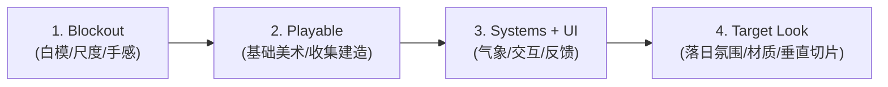

# VISUAL_LANGUAGE.md — 视觉与摄像机规则

> **视觉北极星 (Visual North Star v0.1)**  
> 详见概念设计资产：[`snapshots/snapshot_00_visual_north_star.png`](file:///d:/OneDrive/Learning/Code/Gemini/wild/snapshots/snapshot_00_visual_north_star.png)（原稿：[`design_assets/Codex Image Sep 12, 2026, 03_30_15 PM.png`](file:///d:/OneDrive/Learning/Code/Gemini/wild/design_assets/Codex%20Image%20Sep%2012,%202026,%2003_30_15%20PM.png)）

---

## 1. 摄像机核心参数 (The Orthographic 45° ISO)

本项目正式确立采用 **正交 45° 等距视角 (Orthographic 45° Isometric)**：

```text
Camera Type:          Orthographic (无透视消失点，平行投影)
Horizontal Rotation:  45° (固定的对角对方位角，保证对角线方阵平衡)
Vertical Pitch:       35° – 45° (经典等距 35.264°，保留 35°–40° 视感微调区间)
Initial Size:         18.0 [TUNE] (Godot 正交 size 代表 KEEP_HEIGHT 垂直高度，16:9 下宽约 32m)
Clipping / Cutaway:   支持沿地形/雪洞壁平滑做剖面切削（Cutaway View）
```


### 为什么选择正交 45° ISO？
1. **美术资产生产极其友好**：同一棵松树、同一块岩石，只要旋转 90°/180° 或水平镜像，即可直接复用，完全无透视形变。
2. **空间与尺寸绝对精准**：雪坡倾角、雪洞壁厚、积雪深度、移动距离等在屏幕上呈现恒定像素比例，方便玩家进行“空间工程规划”。
3. **内外视角无缝切换**：当展示雪洞内部时，正交剖面（Cutaway）与外部雪坡能维持在同一视觉体系下，无需切换第一人称或破坏沉浸感。
4. **极利于前期原型验证**：无论是 Low-Poly、灰模方块、还是手绘平贴图，都能自然融合，避免前期陷入昂贵的 3D 拟真模型泥潭。
5. **符合核心玩法心流**：我们做的是**“观察 + 规划 + 决断”**，上帝正交视角让玩家像一位冷静的雪原勘测工程师。

---

## 2. 色彩与光影哲学 (Palette & Lighting)

```text
       [环境基底]                             [庇护所 / 能量核心]
   蓝 (Deep Navy)                         暖橙 (Amber / Flame)
   灰 (Storm Grey)         ─────── VS ───────      暖金 (Sunset Gold)
   白 (Glacial White)                       烛光白暖 (Warm Glow)
  (压迫、肃杀、广袤)                           (安全、生机、喘息)
```

1. **环境色调（80% 视觉占比）**：
   - 以低饱和度蓝、冷灰、雪白为绝对主色调。
   - 阴影偏深紫冷蓝，迎光面偏冷青白。
2. **光源色调（20% 强调点睛）**：
   - 暖色只在三种情况下出现：
     - **低角度冬日落日**（在雪原上拉出长长的金色斜阳）；
     - **倒棚前的反射火**（开放庇护所的主要暖光）与**雪洞内的烛灯**（醒着时的一小团琥珀色，入睡熄灭）；
     - **提灯 / 探针高亮**。
3. **对比感强化**：
   - 外部越是风雪交加、昏暗青蓝，庇护所里的那一点暖光就越令人心安。

### 2.1 天空背景层 (Sky Backdrop)

正交俯视下，相机本身看不到天空。所以天空做成**背景层**，用来同时表达**时间**和**天气**。

| 项目 | 规则 |
| :--- | :--- |
| 实现 | `Environment.background_mode = Canvas`：用一个低层级的 CanvasLayer 当 3D 背景（天空渐变 shader + 太阳 / 月亮圆盘 + 2–3 层远山剪影）。只在 3D 地形没有覆盖的地方露出来 |
| 露出位置 | 地图远端（画面上沿，西北方向）设计成**下降的山谷边缘**，让天空占画面上方约 15–25 % `[TUNE]`；相机靠近地图另一侧时，天空可以不出现 |
| 反映时间 | 渐变三段：冷白 → 金黄 / 玫瑰 → 暮蓝 → 夜色（Web 原型 `lightColor` 的三段式）；太阳圆盘随时间向西下沉，日落后换成星点 |
| 反映天气 | 云量（晴 → 阴 → 暴风雪）压暗、压平渐变；降雪越强，背景越灰白、远山越模糊；暴风雪时远山完全消失 |
| 唯一数据源 | 一个 `AtmosphereState`（时间、太阳方向和颜色、天空渐变、雾色和雾密度、云量、降雪强度）。天空背景、方向光、环境光、雾、雪粒子**都读同一份数据**，保证天空颜色和地面光照永远一致 |
| 天空看不到时 | 时间和天气仍然通过方向光颜色和角度、阴影长度、雾色、雪粒子密度在整个画面里体现 |
| 地平线衔接 | 3D 远景雾色 = 天空地平线颜色，避免地形边缘出现硬接缝 |
| 已知限制 | 地图约 100 m，画面只覆盖约 32 m 宽，所以**大部分时间天空不在画面里**，只有走到远端边缘才看得到 |
| 备选（M1 验证后再定） | ① 画面顶部固定一条很窄的渐变天空带（屏幕空间，带远山剪影）；② 进入过夜 / 报告画面时把相机拉远，露出完整天空 |

---

## 3. 极简 UI 与去游戏化表现 (Minimal HUD)

- **World-Space Information (让世界本身传达信息)**：
  - 不做悬浮的风向箭头 UI —— 玩家通过**空中狂吹的雪尘、剧烈摇摆的树梢**判断风向风速。
  - 不做夸张的头顶血条 —— 玩家通过**角色呼吸哈出的白汽频率、行走颤抖动作**感知体温。
  - 不做艳俗的拾取物描边 —— 枯木本身有泛灰脱皮的材质区分，仅在光标移上时给予极其内敛的**浅琥珀色微弱描边 (Subtle Warm Highlight)**。
- **Screen HUD & World-Space Annotations (世界内微注记体系)**：
  - **右上角极简环境卡片 (Environment Widget)**：
    - 日期时间与日落倒计时：`Jan 14 14:20` / `Sunset 16:18`
    - 环境温度与风况：`-17°C` / `W 32 km/h`
    - 认知提示：`Strong winds from west. Leeward slopes are safer.`
  - **右下角定向罗盘 (Wind Compass)**：
    - 标定 N/S/W/E 方位，并以动态弧度指示西风主导方向与迎风/背风状态。
  - **世界空间微标签 (Floating In-World Cues)**：
    - 探针即时读数：`Good depth 1.8 - 2.1 m`（带落点垂直基准标尺）
    - 地形潜能锚点：`Deeper snow (Ideal for shelter)`（背风雪堆处的微弱圈形标）
    - 资源识别与交互：`Deadwood (Harvest for fuel)`（仅在光标悬停时给出弱橙圈与小图标）
    - 空间剖面标注：在雪洞截面直观展示 `Vent/Chimney`、`Raised sleeping platform`、`Cold-air pit`。

---

## 4. 阶段里程碑体系 (Same Game, Increasing Fidelity)

依据概念图底部确立的 **4 阶递进交付模型**，确保同一款游戏在开发演进中仅提升画面保真度（Fidelity），而不偏离核心逻辑：



### 里程碑定义表：

| 阶段 | 里程碑名称 | 画面中必须呈现的要素 | 验证的核心目标 |
| :--- | :--- | :--- | :--- |
| **01** | **Blockout** | 纯灰模白块地形、低多边形灰树、等距网格、测试角色胶囊/小人、45° 正交相机 | 验证核心空间尺度（80–120m）、45° ISO 移动手感与坡度通过性 |
| **02** | **Playable** | 具有初步辨识度的雪坡、针叶树与直立枯木色彩区分、基础橙圈交互高亮 | 验证采集（Gather）与选址建造（Build）核心闭环与基础生存逻辑 |
| **03** | **Systems + UI** | 动态风雪粒子系统、右上角 HUD、探针测深反馈、雪洞 Cutaway 剖面 | 验证环境阅读（Read the Land）、气象压迫感与 UI 反馈流畅度 |
| **04** | **Target Look** | 低角度落日体积光、雪地凹陷脚印（Displacement）、树冠积雪微动、冷暖极致对比 | 达到并呈现概念图（Visual North Star v0.1）水准的完整垂直切片 |

